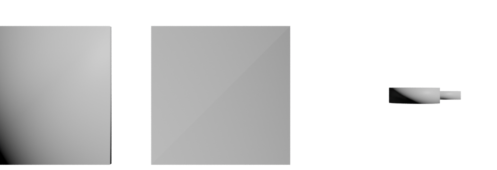

# Art regeneration: a staged plan

Snapshot date: 2026-11-25 (second revision the same night, after two review passes and the
ownership decision). Branch `master`, HEAD `a27d7154`.
Numbers were measured by `mesh_audit.py` (copied here; full table in `audit-table.txt`) and
re-derived independently by `verify_review.py` (also copied here). Where the two disagreed, this
text uses the second measurement and says so. They describe the tree as it stands, not a proposal.

## 0. The three decisions this version is written against

1. **The scripts generate; the owner is the eye.** Geometry, UVs and per-face painting are all
   reproducible headless, so generation is not a hand-authoring job. What is not automatable is
   judgement about the result.
2. **Toolchain home is `utils/art/`, with `utils/art/blender/` under it** for scripts that run
   inside the Blender binary.
3. **Files the game does not load may be deleted** — which turns out to buy exactly one file, and
   that file is the report's own headline example. So it goes first (Stage −1), before any rule or
   `KNOWN` list is written about it.

## 1. What the catalogue actually is

| | count |
|---|---|
| `.obj` files in `res/meshes/` | 83 |
| rows in `res/data/parts.json` | 87 |
| textures in `res/textures/` | 37 |
| distinct shape *families* | ~20 |
| true hand-made prototypes | 3 — capsule, fuel tank, engine (owner) |
| Python mesh generators | 13 |

The 83 files are a shape vocabulary plus a scale table. `tank_r1.5h3.obj` is `capsule.obj`'s family
at ×1.5; `docking_port_*`, `reaction_wheel_*`, `materials_pod` are one disc at three scales; the
**eight** engine meshes (`engine`, `engine_r0.25h1`, `engine_r1.5h3`, `engine_r2.25h4.5`,
`nuclear_engine`, `orbital_engine`, `orbital_engine_r1.5h1.5`, `orbital_engine_r2.25h2.25`) are all
**one lathe of 192 verts / 162 faces** (160 quads + 2 32-gon caps) stretched in z. `jet` is a *part*
that borrows `engine.obj`, not a ninth file. `nuclear_engine` is that lathe at **1.5× z** (z-span
3.000 vs 2.000), not 3×.

"~20 shape families" is a family count (drum, tank, disc, frustum, nose cap, shroud, fuselage,
plate, box, ladder, lathe, gear, leg, kerbal, rcs, liftbody, chute, platform, deck, plume), not a
file-level "originals" count — an earlier draft quoted 30 originals from a uniform-scale scan that
was never committed, so that number is dropped rather than trusted.

**Nobody has to author 83 anything.** That is what makes this tractable.

### What actually reaches an asset (needed before anything is deleted)

Nine paths, not one. A parts.json-only test misclassifies **16 of 83 meshes and 5 of 37 textures**:

| path | load site |
|---|---|
| `parts.json` `mesh` / `texture` / `chute_mesh` / `chute_texture` / `shroud` / `shroud_texture` | `src/part.cpp:24-41` |
| `res/data/buildings.json` `mesh` / `texture` | `src/buildings.cpp:61,66-71`, `494-495`; `src/render.cpp:1706-1707,1752-1753` |
| `buildings.json` `collision_mesh` | `src/buildings.cpp:499` (pinned at `tests/test_buildings.cpp:380`) |
| VAB preview of a building | `src/vab.cpp:41` |
| hard-coded strings | `src/main.cpp:1157` `meshes/engine_plume.obj`, `:1158-1174` plume + HUD icons; `src/terrain.h:670` |
| `system.json` `"skybox"` = a **directory**, faces named by suffix | `src/system.cpp:508-530`, `src/skybox.cpp:24` |

Measured: 8 meshes are absent from parts.json under every key — `balloon_platform`,
`balloon_platform_deck`, `runway`, `space_port`, `spacedock`, `station` (all reachable through
`buildings.json`) and `engine_plume` (hard-coded) — plus **`wing.obj`, which nothing can reach**.
Same story for textures: 5 building textures have zero references outside `res/`, and 0 of 37
textures and 0 of 12 skybox PNGs are unreachable.

## 2. Shading today (the owner's hunch, measured)

| | now | after Stage −1 |
|---|---|---|
| meshes flat (one normal per face) | 66 of 83 | 66 of 82 |
| meshes with interpolated faces | 17 of 83 | 16 of 82 |
| faces whose corner normals deviate > 5° | 4752 of 14415 | 4744 of 14407 |
| worst corner-normal gap | **87.1°** `wing.obj`, then 70.5° | **70.5°** (`fin_*`, `wing_*`, `runway`), 54.7° (`leg`, `gear`, `station`, `spacedock`) |

The engine honours whatever the file says: assimp keeps one normal per vertex
(`src/mesh.cpp:29-33`, no `GenSmoothNormals`) and `partsShader.vs/fs` interpolate `normal0` with no
`flat` qualifier, so flat-vs-smooth is decided entirely by the `vn` lines.

The defect is narrower and worse than "some are smooth". The box families (`fin_*`, `wing_*`,
`runway`, plus `station`/`spacedock` via trimesh) carry **one corner-averaged normal per vertex** —
`fin_r1h2.obj` has 8 verts and 8 normals, and the corner at (+,+,+) is
`vn 0.577350 0.577350 0.577350`, the average of the three meeting faces:



*left:* `fin_r1h2.obj` as shipped — no face edge is readable, the whole plate is one gradient.
*middle:* the same box with flat normals. *right:* `gear.obj`, smooth — and smooth is right there.

This is a generator bug, not a style choice (`utils/gen_wing.py`, `gen_runway.py`,
`gen_station.py`) — filed as **#1178**.

**The low-poly note matters here, and it points the same way.** A coarse mesh with smooth normals
is exactly what produces the pillow. A coarse mesh with flat normals is what makes low-poly read
as a decision instead of a mistake. So Stage 1 is not just consistency: it is the aesthetic.

Cost of per-face normals, measured as corner tuples per vertex (the only denominator that moves):
`fin_r1h2` 8 → 36, `wing_r2h2` 8 → 36, `station` 24 → 108, `leg` 66 → 360. Face and draw-call
counts do not change. `capsule.obj` needs **no** added corners at all — but not for the reason an
earlier draft gave: the authored art already emits **per-face** normals (34 `vn` for 34 faces,
`f 1/1/1 2/2/1 4/3/1 3/4/1`), and its 192 corner tokens are all distinct because of the *UV*
indices, not the normals. So capsule is ×1.0 under "corners added", not because of some other
metric. It is *not* trivial for `balloon_platform.obj` (3950 → 23544 corners, ×5.96) — which is
smooth on purpose and stays that way (#1179).

## 3. UVs today (the bigger blocker)

| bucket | now | after Stage −1 |
|---|---|---|
| real UV area | 51 | 51 |
| UV layer present but **zero area** | 22 | 21 |
| **no UV layer at all** (falls back to texel (0,0), `src/mesh.cpp:62-69`) | 10 | 10 |
| **cannot be painted** | **32** | **31** |

The zero-area bucket is not one kind of file, and Stage 0 has to tell them apart:

- **13 one-texel files** — the 4 fuselages (every `vt` is `0.5 0.5`), 3 fins, 6 wings, `runway`
  (all `0 0`). Painting these changes one texel and nothing else. The four fuselages point at
  `textures/capsule.png`, whose centre texel (256,256) is **white**, so they read white regardless
  of what the file otherwise contains (#1173).
- **8 `*_shroud.obj`** — a degenerate *strip*: 32 distinct texels along `v = 0`. Zero area, but
  painting a **row** of `engine_shroud.png` does change what draws. These need a real unwrap, not
  a rescue from nothing.

Where UVs exist, density is uneven (#1176):

| family | px/m low → median | ratio |
|---|---|---|
| `capsule.obj` (authored) | 100.8 → 100.8 | **1.0** |
| `tank_r1.5h3.obj` (authored) | 54.4 → 54.4 | 1.0 |
| `nose_cap*` | 64 → 194 | 7.4 |
| `adapter_*` | 17 → 159 | 6.4 |
| `capsule_cyl_r1h2` (`gen_adapter.py`) | 37 → 119 | 3.2 |
| Blender Smart UV Project (probe) | 80 → 106 | **1.3** |

Catalogue median ratio 1.7, 25th 1.2, 75th 2.8.

Island margin, measured (corner-to-corner, 512² canvas): the **only** family that separates its
islands is the lofted one, at **10.67 px** — because `utils/gen_adapter.py:98-101` lays islands on
a `ceil(sqrt(34)) = 6` grid with a `0.0625 × cell` inset, so the gap is `0.125 × cell × 512`.
Everything else is continuous: authored lathes are one strip, and `nose_cap.obj` islands touch at
0.00 px. So Stage 3's "≥12 px margin" is **stricter than anything currently shipped**, not a
restatement of it. `gen_adapter.py:22`'s reason for the inset is that the min filter is
`GL_LINEAR_MIPMAP_LINEAR`; no measurement here says where bleeding actually starts, so the number
is a taste call with a source, not a cliff.

## 4. Poly budget (the constraint that bounds every stage)

| | now | after Stage −1 |
|---|---|---|
| catalogue faces | 14415 across 83 meshes, mean 174 | 14407 across 82, mean 176 |
| the outlier | `balloon_platform.obj` 7848 = **54.4% of every face in the game** | same |
| next tier | `fuselage_*` 624 each, `kerbal` 448, everything else ≤ 192 | same |

A budget rule is cheap and worth pinning — but it must say **which** faces it counts, because the
two answers differ ~2× and the rule is only as good as its unit. Assimp runs
`aiProcess_Triangulate` (`src/mesh.cpp:31`), so `fuselage_*` is 624 *file* faces and ~1248 *drawn
triangles*. Decision: **the gate counts file faces** (that is what a generator emits and what a pin
can compare), ceiling ~650, with `balloon_platform` carrying an explicit named exception. If we
ever want the drawn-triangle budget instead, the ceiling has to move before the rule does.

Engines keep 32 lathe segments (that is what `engine.obj` uses: 6 rings × 32) and grow the contour
to 8–10 points: 7–9 bands × 32 quads + 2 caps = **226–290 file faces** (~450–580 drawn). Low-poly,
and under the file-face budget with room.

## 5. What Blender already gives us (proven, not assumed)

Headless 4.5.9 LTS (`~/opt/blender-4.5.9-linux-x64/blender`):

- **Smart UV Project** on a bmesh lathe: proportional UVs (ratio 1.3) for free, identical geometry
  (volume 2.731265 m³, so masses do not move), flat normals, quads/ngons preserved
  (`export_triangulated_mesh=False`), byte-identical across runs.
- **The base image the owner uses**: `bpy.ops.image.new(generated_type='UV_GRID')`. The headless
  512² grid has the same 32 px cells and the same two greys, `(64,64,64)` / `(150,150,150)`, as
  `res/textures/capsule.png`, and **66.21% of `capsule.png` (173575 of 262144 px) is byte-identical
  to it**. `COLOR_GRID` is not what we use (0.01%). Caveat for Stage 3: that figure only holds if
  the exporter writes the **raw `image.pixels` buffer** — `image.save_render()` runs a colourspace
  transform and matches 0.00%.
- **Per-face colour**: fill `image.pixels` over the selected faces' UV polygons. Painting faces 0
  and 31 white on the shipped `capsule.png` changed **0 pixels**; painting them red changed
  **5312 px (2 × 2656)**, all inside those two faces. The white pair in the authored art *is*
  faces 0 and 31, azimuth +84.4° / +95.6° — an adjacent pair straddling +Y.
- **Flat vs smooth control**: `polygons[i].use_smooth`, one normal per face on export.

Not reachable headless, so the plan must not depend on it: **the brush stroke itself**.
`tool_settings.image_paint.mode = 'IMAGE'` ("Single Image, no materials") exists and
`TEXTURE_PAINT` can be entered with no GUI, but `paint.image_paint` reads the mouse event and
hangs indefinitely under `--background` (`tmp/night7/probe_stroke.py`, 120 s, no output). The
"mask to selected faces" toggle is not an RNA property in 4.5 (no `select*` on `Brush` or
`ImagePaint`). The *result* of the gesture is exactly reproducible; the gesture is not.

## 6. Who does what (changed from the first draft)

The first draft proposed: owner authors meshes and textures in Blender, this side confirms them in
game. That mirrored a suggestion rather than what the measurements support — geometry, UVs and
per-face painting are all reproducible through the API, and 13 of the mesh families are already
procedural.

So: **the scripts generate; the owner is the eye.** What cannot be automated is taste — whether the
bell is the right shape, whether a white pair reads at 40 px on screen, whether the greys are too
flat — and that is the cheapest thing the owner can give. The loop is generate → F12 frame →
"wider skirt, darker, stripe on the other side" → change a parameter.

That also removes the last hand-authored dependency: with a scripted engine the catalogue becomes
**fully regenerable**, and **four** `UNPINNED` excuses in `check_mesh_pins.py` stop existing —
`wing.obj` (deleted in Stage −1), the two rescaled nose caps whose header names the unit cap, and
the shroud whose header copies the wrong radius. The fifth (`textures/terrain_detail.png`) is a
*texture* that no stage in this plan regenerates, so it stays.

## 7. The staged plan

### Stage −1 — delete the file nothing loads
`res/meshes/wing.obj`. Proof it is dead: `git grep -n "wing\.obj"` yields only its own `UNPINNED`
excuse (`utils/check_mesh_pins.py:148`), a comment in `utils/gen_wing.py:11`, and dead `reports/`.
It is in no `parts.json` key, no `buildings.json` key, no `src/` literal, no test, no e2e case, no
fixture. Its header claims `gen_wing.py`, and that script with the recorded defaults is 13 lines and
4 bytes off a different shape (different apex, an extra corner).

Three-line change: the file, the `UNPINNED` entry, the `gen_wing.py` comment. `#1052` ("four shipped
meshes name a generator that did not make them") loses one of its four. Do this **before** Stage 0,
or the `KNOWN` table is born with an entry for a file we intend to delete, and §2/§3/§4 above need
two columns instead of one.

While in there, close the hole that made this a grep instead of a fact: `UNPINNED` keys are never
checked to name an existing file (`PINS` outputs are, at `check_mesh_pins.py:485-489`), so a
deletion can leave a silent stale excuse. Add "every `UNPINNED` / `KNOWN` key names an existing
file".

### Stage 0 — write the style down, and make the gate check it (no Blender)
A new table in `utils/check_mesh_pins.py` (not `TOPO` — adding a plate to `TOPO` reports four
problems, three of which a plate legitimately has):

- `FLAT` / `SMOOTH_OK` families + a max angular deviation (5° reproduces the audit exactly),
  with normals compared **by value**, not by index;
- every mesh has a UV layer whose faces enclose non-zero area, reported **as two rules** —
  one-texel vs degenerate-strip (§3) — so the strip shrouds are not quietly lumped in with the
  plates;
- per-face density within 2× of the part median;
- a face budget per part mesh (~650 **file** faces) with named exceptions.

Today's catalogue fails ~16 shading rows and ~31 UV rows, so failures go in a `KNOWN` list that
shrinks as families are fixed. **Three properties of the existing file make "shrinks" need teeth**,
so they land with the table rather than later:

1. Key it `(path, rule-phrase)` the way `SELFTEST` already phrase-matches (`:446-449`).
   `topo_problems()` early-returns twice (`:263-266`, `:278-281`), so a catalogue-wide run yields at
   most ~3 problems per file; a `path → reason` table cannot express "fails these two, will fix the
   third".
2. **A `KNOWN` row whose problem no longer reproduces is a failure.** Nothing in the file forces
   `UNPINNED`-shaped lists to shrink or even to name a file that exists, so the "bookkeeping" risk
   in §10 is only manageable if the gate enforces the pruning.
3. `--committed` iterates `sorted(TOPO)` only (`:493`) and its guard is `set(TOPO) <= PINS outputs`
   (`:480`), which does not cover a catalogue-wide table — the committed half needs its own loop.
   While in there, the `topo_ran < len(TOPO)` print block is duplicated at `:551-556`.

**One existing rule is broken and must be fixed regardless.** `check_mesh_pins.py:244` decides
"more than one normal" from normal *indices*:

```python
mixed = sum(1 for f in faces if all(x is not None for x in f[2]) and len(set(f[2])) != 1)
```

It is **latent today** — `topo_problems()` only ever runs over `TOPO`'s 7 rows (`:497`, `:521`) —
and it fires the moment Stage 0 grows that table, on `decoupler_radial.obj`, `barometer.obj` and
`ladder*.obj`, whose faces are flat by value (gap 0.0°):

```
python3 -c "import sys; sys.path.insert(0,'utils'); import check_mesh_pins as m; \
  print(m.topo_problems('res/meshes/decoupler_radial.obj', 12))"
```

That is the same class of failure as the island compare in the #1170 review round — a rule that
cannot fail correctly — and it needs a SELFTEST case where indices differ but values match.

Cost: a full 83-mesh sweep is 0.059 s in stdlib against a ~0.02 s wall for the whole `--committed`
step today, so the catalogue-wide rules roughly quadruple that step and still fit it.

### Stage 1 — per-face normals in `gen_wing` / `gen_runway` / `gen_station` / `gen_leg`
One normal per face instead of corner-averaged. Positions untouched, so volumes, masses, hulls and
every mass pin stay identical (verified through assimp: `fin_r1h2` signed volume 0.400000, `wing`
0.200000, `capsule` 2.731265, `station` 1080 — unchanged). **11 pin rows re-record, 12 asset files
regenerate**: 8 `gen_wing` outputs, `runway`, `station`, `spacedock`, `leg`.

`leg` is in because it is machined flat — strut plus footpad, not a wheel. `leg`'s mass is declared
(`gen_parts.py:506` region), so nothing moves. Note that `leg.obj` has **no `vt` at all**, so
flattening it does not make it paintable; it stays in #1173's list.
`decoupler_radial` / `barometer` / `ladder*` need nothing (already flat by value).

### Stage 2 — `utils/art/blender/gen_lathe.py` for the lofted family
The 6 adapters, `capsule_cyl_r1h2`, 3 nose caps, 8 shrouds — the worst UVs (3.2–7.4). Header names
the Blender version and the operator settings; a Blender-guarded pin class runs it when `blender`
is on PATH and prints `SKIP -- no blender` otherwise (the same shape as the trimesh guard in
`test-art`); `TOPO` loosens from `islands == faces` to `islands <= faces` plus the density rule.
Geometry is meant to be identical → masses identical. Prototype: `tmp/night7/gen_capsule_bpy.py`.

This is the stage where a geometry slip actually moves mass, not Stage 2b: adapters, nose caps,
capsules, cargo and tanks are the **volume-derived** families (`gen_parts.py:903` else-branch).
`clean()` rounds masses to 2 dp (`:623-626`) so a 1e-6 slip is absorbed, but `mesh_geom` rounds
`radius`/`height` to **3 dp** (`:574`) — that is the number the catalog and the skin checker pin
against.

### Stage 2b — `utils/art/blender/gen_engine.py`, and make the nozzle mean something
The engine is already a lathe: 6 profile rings × 32 segments, and the owner confirms the shape is
"vaguely engine shaped", so this silhouette is free to change (unlike the capsule and fuel tank,
which stay pinned). Measured profile today, with the radii the file actually carries:

```
z -1.000 r 0.3497   exit      (A_exit/A_throat = 7.56)
z -0.600 r 0.3179
z -0.300 r 0.2543
z  0.000 r 0.1272   throat   |  r 0.7611  chamber rim
z +1.000 r 1.0000   mount    <- the widest ring in XY, and therefore the part's radius
```

Physically, nozzles scale by **expansion ratio**, not height — which is why `nuclear_engine` today
is just a 1.5× taller `engine` with the same stubby bell. Proposal, to iterate on with the owner's
eye:

| class | throat r | exit r | ε = A_exit/A_throat | bell half-angle | file faces |
|---|---|---|---|---|---|
| boost (`engine*`) | 0.13 | ~0.58 | ~20 | 20–25° | ~230 |
| vacuum (`orbital_engine*`) | 0.11 | ~0.90 | ~67 | 12–15° | ~230 |
| nuclear (`nuclear_engine`) | 0.13 | ~1.00 | ~60 | 8–10°, shorter | ~230 |

Same 32 segments, 8–10 contour points → 226–290 file faces.

**How this moves gameplay is narrower than it looks, and the earlier draft had it backwards.**
Engine mass is *not* volume-derived: `gen_parts.py:748-766` sets `mass = thrust × mass_per_n` with
`thrust = ENGINE_THRUST_PER_M2 × radius²`, and `radius` is the mesh's max XY half-span
(`mesh_geom`, `:560`). Today that is the **mount** ring (r 1.000 at z +1.0; `engine.obj` → radius
1.0, mass 500; `engine_r1.5h3` → 1.5, mass 1125). Every exit radius proposed above sits at or below
the mount ring, so **re-profiling the bell moves no mass and no thrust at all**. The lever is which
ring is widest:

- **Keep the mount ring widest** (as above): silhouette changes, `radius`, `height`, thrust, mass,
  dv, TWR all stay put. Cheapest, and the default for Stage 2b.
- **Let the bell be the widest ring** (what real engines do): then thrust literally follows bell
  diameter, which is a defensible physical model — but it is a tuning change, and it belongs in its
  own commit with a `--fleet-report` before/after, because it moves `radius` → thrust → drag →
  nodes → dv. Either way #1172 is *not* the issue in play here; that one is about the
  volume-derived families, i.e. Stage 2.

`height` is still a real lever in both options: it feeds drag, node placement and attach.

### Stage 3 — textures from a script, per part
UV grid base (66.21% of `capsule.png` already is one — raw `image.pixels`, see §5), flat greys,
per-face marks including the +Y orientation pair, island margins ≥12 px (stricter than the 10.67 px
shipped today, deliberately), one PNG per part (the owner rejected a shared palette). Stage 2 has to
land first for wings/fins/fuselages/shrouds, or there is no canvas to paint on. Its blast radius is
small: no pin touches a texture except that `res/data/parts.json` is regenerated in CI by
`gen_parts.py --check` (`Makefile:706`) — which is where the `texture` strings come from — and the
five building textures can only be repainted through `res/data/buildings.json`. No test or e2e case
samples texture pixels.

### Stage 4 — retire the replaced generators
When a shape has a Blender generator, delete the old one and keep only the scale table. End state:
~20 scripted shapes + a scale table + the handful of one-offs still worth writing by hand, every
asset byte-reproducible.

## 8. What I would not do

- **Do not convert all 13 generators in one pass.** 30 files of churn, every pin moving at once.
  The stages above move one family per commit — and Stage 1 / 2 / 2b touch **disjoint** file sets
  (verified), so that claim is safe.
- **Do not regenerate the capsule or fuel tank silhouettes.** They are readable, they are the only
  art at density ratio 1.0, and they are what a player recognises in the hangar. A script may
  reproduce them; the shape stays pinned. (The engine is explicitly *not* pinned.) Caveat from the
  fixtures below: "stays pinned" only protects those rows if the **bytes** stay identical, which no
  Blender export guarantees.
- **Do not change geometry and repaint in one commit.** Geometry moves mass, and mass moves e2e
  pins (staged mass, dv, TWR); texture moves pixels only. Otherwise a red `make test` cannot be
  attributed.
- **Do not flatten the deliberately-smooth family.** `gear`, `balloon_platform*`, `kerbal` are
  smooth on purpose (`leg` has moved out of this list — it is flat); the whitelist exists so nobody
  "fixes" the others later.
- **Do not ship the flattener as written.** Review found real defects, all still unfixed in
  `utils/flatten_normals.py`: it re-serialises coordinates to 6 decimals, so it is *not* idempotent
  (`gear.obj`'s md5 changes twice before settling) and it silently drops digits from the 8-decimal
  trimesh files; measured on `balloon_platform`, that moves enclosed volume by **1.44e-8 relative**
  (23636.524650825 → 23636.524309738) — an earlier draft said 1.6e-6, which is the per-*coordinate*
  error, not the volume error. Either way the point is that a normals-only tool should not touch
  coordinates at all. Also: `--check` compares whole-file bytes rather than normal values, so it
  calls **82 of 83** meshes drift (only `adapter_r1.5to2.25.obj` is byte-identical); corner indices
  are half-validated (an invalid `f 1/1/1 0/2/2 3/3/3` reads the last vertex in the file); a
  multi-object or `usemtl` file would be silently merged, which matters because `src/mesh.cpp:47`
  only reads `mMeshes[0]` — hypothetical today (0 files carry more than one `o`), but cheap to
  assert; and it clobbers in place with no `--out`, exactly the policy #1051 exists to enforce.
  Fix: carry the original coordinate text verbatim, compare by value, validate corners like
  `check_mesh_pins.obj_corner()` does, assert ≤1 object per file, require `--out` / `--in-place`.
- **Related loose thread found while auditing:** all 36 Blender-authored meshes carry
  `mtllib X.mtl` + `usemtl`, and **no `.mtl` exists anywhere in `res/`**. The engine binds the
  texture from `parts.json` and ignores them, so they are harmless dead lines — but they are also
  the kind of lie this plan is supposed to be killing.

## 9. Where the scripts live (settled: `utils/art/`)

`utils/art/` for the art toolchain, `utils/art/blender/` underneath for scripts that run inside the
Blender binary — `gen_lathe.py`, `gen_engine.py`, `inspect_mesh_blender.py`, the figure renderer,
later a face-paint tool — plus a `README.md` naming the Blender version (4.5.9 LTS here) and the
`--background --factory-startup --python <script> -- <args>` form. Plain-Python generators and the
gates (`check_mesh.py`, `check_mesh_pins.py`, `flatten_normals.py`, `rescale_obj.py`) live in
`utils/art/` too.

An earlier draft justified this by saying a directory named `bpy` would shadow Blender's module for
`--python` scripts. **That claim is wrong**: under the Blender binary `sys.path[0]` is
`…/4.5/scripts/startup`, not the script's directory, so `utils/bpy/` would *not* shadow `bpy` there
(it does shadow for plain `python3`, which was reproduced) — and `python3 utils/inspect_mesh_blender.py`
cannot import `bpy` outside Blender anyway, so the file named as the casualty was never at risk. The
decision stands on other grounds: a name that collides with an import inside our own python
toolchain, and grouping the whole toolchain in one place.

Moving is a staged thing, not one `git mv`:

- the six `IN_PLACE` generators (`check_mesh_pins.py:53`) are exactly the six that do
  `from gen_out import add_args, ship` (`gen_gear`, `gen_leg`, `gen_ladder`, `gen_kerbal`,
  `gen_platform`, `gen_station`) — they break unless `gen_out.py` moves with them or becomes
  importable from both levels;
- `check_mesh_pins.py:458` builds generator paths as `os.path.join(HERE, script)`, so the gate has
  to learn the new location in the same commit as the files it runs;
- `Makefile:706,720,840` and `.gitea/workflows/lint.yml` hard-code `utils/check_mesh_pins.py` and
  `utils/gen_parts.py`.

Rule: move **one layer per commit** — generators, or the gate, or CI — never two.

## 10. Costs and risks, honestly

| stage | effort | new dependency | risk |
|---|---|---|---|
| −1 | minutes | none | none found: no load path, no pin, no fixture |
| 0 | ~half a session | none | `KNOWN` bookkeeping (needs the teeth in §7), one existing rule must be fixed first, `--committed` step ~4× slower |
| 1 | ~1 commit | none | 12 asset files churn; positions unchanged so no mass moves; corners ×4.5 on small meshes |
| 2 | 2–3 commits | **Blender on PATH to regenerate** | a Blender version bump can move export bytes; pins must key on measured properties (islands, density, volume), not file bytes; **masses are volume-derived in these families** |
| 2b | 1–2 commits | Blender | #456 fixture hexes must be restamped; gameplay only moves if the widest ring or `height` moves (then thrust/drag/dv move) |
| 3 | per family | Blender for the grid base | painted marks need margins or they smear under mipmapping |
| 4 | small | none | deleting a generator removes the scripted fallback for that shape |

**Which pins move at which stage** (the failure mode to plan around is `partGeomFingerprint`, #456:
it hashes mesh **file bytes** — `src/shipdef.cpp:212-247` — and `tests/test_shipload.cpp:164-190`
compares the recorded hex in the fixtures against the live catalog):

| stage | what goes red |
|---|---|
| −1 | the `UNPINNED` entry (deleted with it); nothing else |
| 0 | nothing in `res/`; gate self-tests only |
| 1 | 11 byte-pin rows until the files regenerate; `gen_parts --check` stays green (volumes/extents unchanged); **#456 fixtures unaffected** — none of capsule / reaction_wheel / fuel_tank / engine / ladder / leg is in Stage 1, and positions are untouched. This is the strongest argument for doing Stage 1 first. Related e2e cases `1158-a/-b/-c` pin mesh *extents* (`leg.obj spans…`, `gear.obj spans z -0.35..0.65`) — safe under a normals-only change, which is exactly why they should be run once here. |
| 2 | byte pins for the 7 `TOPO` rows + 2 nose-cap `UNPINNED` rows + `engine_r0.25h1_shroud` leave `UNPINNED`; watch `radius`/`height` at 3 dp (volume-derived masses); `utils/check_ship_skin.py` — it runs in `test-gen`, i.e. **in CI** (`Makefile:815-816`), measures half-spans off `res/meshes` vertices and waives 28 surface edges at measured values, so any extent change moves a waiver; #456 only if `capsule` / `fuel_tank` / `reaction_wheel` bytes move (fixtures `save_geom_stale`, `save_geom_stale_root`, and the live-hex `save_hang_parked_hull`) |
| 2b | 8 lathe meshes are unpinned today, so no byte-pin churn; **#456 engine hexes must be restamped** (`save_geom_stale/ships/v0.json:103` deliberately-bad `aeca0efd6dea53e9`, plus the good rows elsewhere); `gen_parts --check` moves only if the widest ring moves — and then thrust, drag and dv/TWR move with it, which is what `--fleet-report` before/after is for |
| 3 | `gen_parts.py --check` (`Makefile:706`, source of the `texture` strings); building textures via `res/data/buildings.json`; no test samples pixels |

**CI reality, and it constrains Stage 2.** `.gitea/workflows/lint.yml` runs `make test-gen` and
`python3 utils/check_mesh_pins.py --committed` — that is all. The regeneration half is `test-art`
(`Makefile:717-724`), behind a `find_spec('trimesh')` guard, and belongs to `make test`, which CI
never runs. So "SKIP -- no blender" is the right shape for the bpy half, but it also means a
Blender-regenerated asset has **zero CI coverage** beyond what stdlib can measure from the committed
file. Every property Stage 2 wants protected — islands, density, volume, face count — must therefore
live in the committed stdlib half, not in the bpy half.

Blender-dependency is not a *new* fragility: the 36 Blender-exported files and the 3 prototypes
already cannot be regenerated at all. Moving the generated half into the same regime as the art is
what makes the catalogue fully regenerable instead.

## 11. Loose ends on the tracker

- **#1176** texel density (§3) — resolved by Stage 2's rule; numbers posted on the issue.
- **#1173** unpaintable meshes (§3, 31 after Stage −1) — needs Stage 0's rule, cleared by Stages 2/3.
- **#1178** box parts shaded like rounded lumps (§2) — Stage 1.
- **#1172** "masses are density × volume and every density was tuned against the wrong volume" —
  surfaced by **Stage 2** (the volume-derived families), not 2b.
- **#1052** four shipped meshes name a generator that did not make them — Stage −1 takes one away.
- **#1179** `balloon_platform.obj` at 54.4% of the catalogue's faces, no UV layer.
- New candidates from this pass, worth filing: `UNPINNED`/`KNOWN` keys are never checked against
  existing files (§7 Stage −1); the dangling `mtllib`/`usemtl` lines with no `.mtl` in `res/` (§8);
  `check_mesh_pins.py:244`'s index-vs-value rule and its duplicated print block (§7 Stage 0).

## 12. Tooling written for this report

In this directory (committed with the report):

- `mesh_audit.py` — the catalogue-wide shading / UV-density / island table (§2, §3, §4).
- `verify_review.py` — the independent re-derivation that corrected the reference census, the
  texture count, the engine-file count, the island margin and the zero-area split. It also documents
  the two paths that reach a mesh but are invisible to a parts.json scan.

Scratch, `tmp/night7/`: `gen_capsule_bpy.py`, `paint_capsule_bpy.py`,
`reproduce_capsule_paint.py`, `bake_face_colors.py` (the bpy proofs in §5); `render_shading.py` (the
figure above, `--rot 0 --dist 7.2 --engine CYCLES`); `probe_paint_api.py`, `probe_stroke.py` (what
the paint API does and does not allow headless).

Committed side effects so far: `utils/flatten_normals.py` exists and is **not** good enough to run
on a shipped asset (see §8). Nothing in `res/` has been touched.
