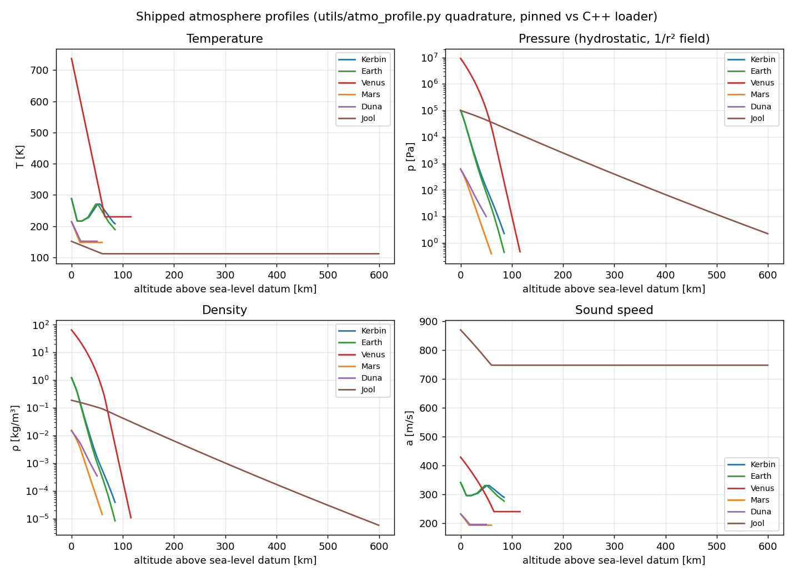
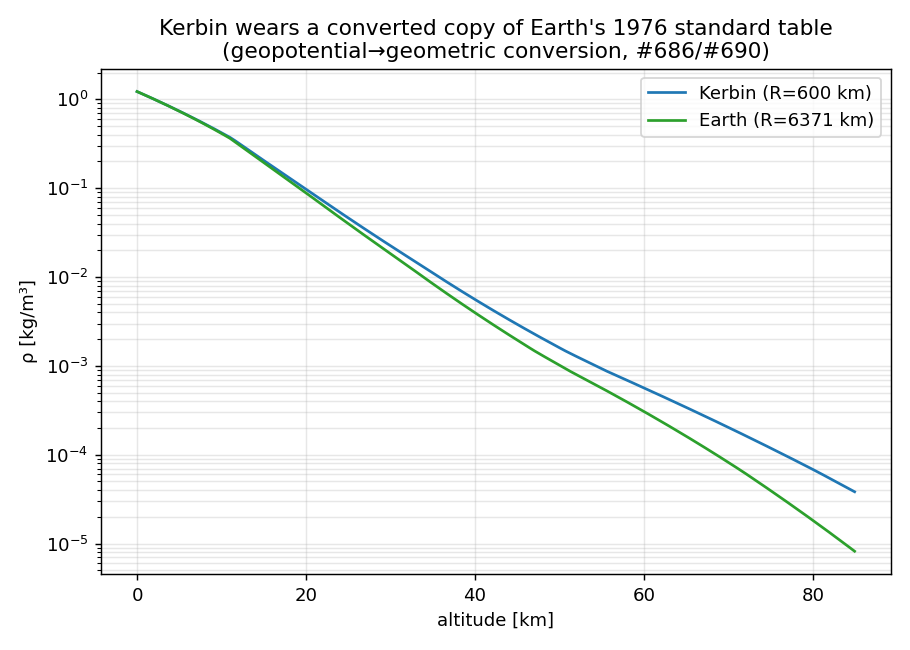
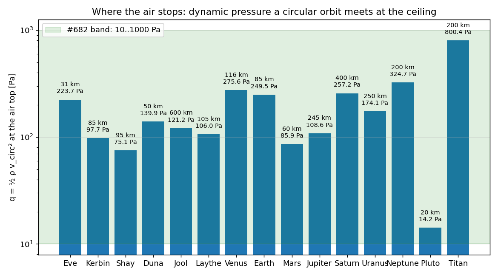
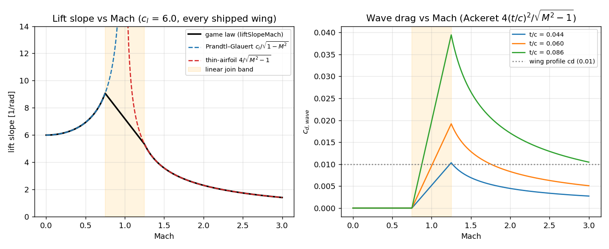
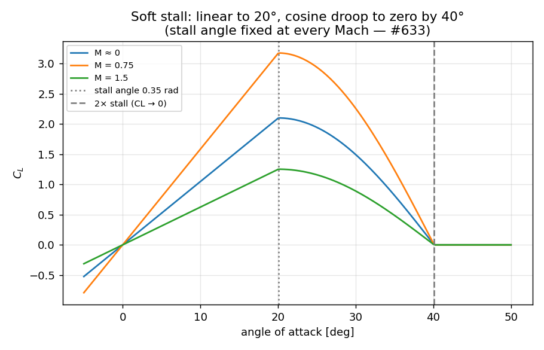
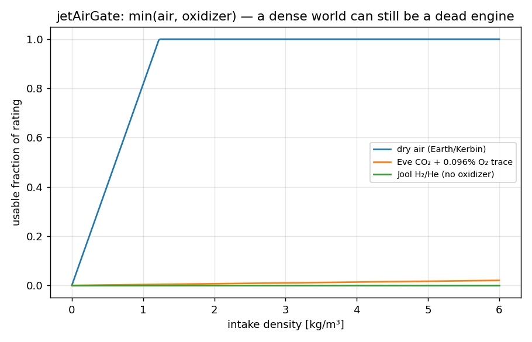
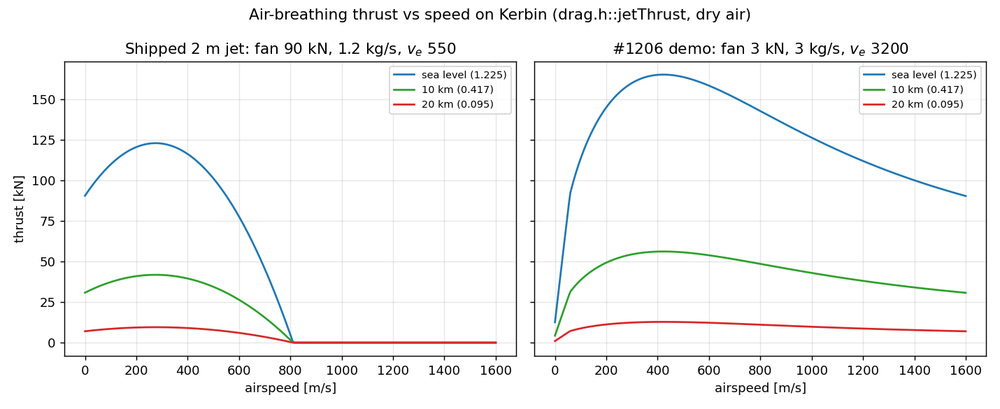

# Atmospheres & atmospheric flight — review, 2026-11-27

A state-of-the-subsystem review for a non-expert reader: what we built, what is
genuinely good, what is weak or missing, and a sketch of what to do next.
Math is in LaTeX; every law cited lives in `src/atmo.h`, `src/drag.h`,
`src/groundtemp.h` and `Vehicle::applyAeroForce` (`src/vehicle.cpp`).

**Method.** Read the four law headers and the vehicle aero pass end to end;
read the shipped system/part data; ran `make test` (all green), two e2e flight
cases (`flight/631` Earth air, `flight/851` runway takeoff — both PASS); swept
the *real* C++ laws with a small harness (`code/curves.cpp`) and plotted the
shipped profiles with the project's own cross-check tool
(`utils/atmo_profile.py`, a quadrature implementation pinned against the C++
loader in `tests/test_scenarios.cpp`). Figures and CSVs are in this directory;
`data/atmo_profile_report.txt` is the full per-body air report. Issue numbers
(`#NNN`) are Gitea tickets, checked open/closed on the day.

---

## 1. TL;DR

**The atmosphere side is in very good shape — better than most space games.**
The air is a real hydrostatic column with temperature layers, gas composition,
gravity that falls off with altitude, and wind as a velocity field. It is
authored once, validated hard at load, and every readout derives from the same
numbers the physics bills. Kerbin/Earth match the US Standard Atmosphere 1976
to ~1% from 0–85 km.

**The flight model is ambitious and mostly sound, but it is a "good textbook"
model, not yet a complete one.** Per-part silhouettes, lift with stall,
compressibility corrections, induced drag, control-surface rigging and a
static-margin readout are all there and heavily tested. The known holes are
honest and tracked: no heating, no structural limits, transonic stall is wrong,
lift ignores aspect ratio, and the blunt-body drag curve ramps through Mach 1
instead of stepping.

**The biggest gameplay gap is air-breathing propulsion.** Both shipped jets
have exhaust velocity 550 m/s, so thrust hits zero at ~810–830 m/s *at any
altitude* — a third of Kerbin orbital speed. The physics to fix it already
works (#1206 demonstrated a scramjet-like part with one JSON edit); what is
missing is parts, intake drag, and a thermal ceiling.

**The biggest process gap is CI.** The push workflow runs lint and generated
checks only — neither `make test` nor the 566 e2e cases run on push (#1205).
A red flight case sat on master for two days recently. For a subsystem this
numerical, that is the first thing I would fix.

---

## 2. How the atmosphere works

### 2.1 One authored statement, everything else derived

A body's system file authors (see `res/systems/*.json`):

- `sea_level_pressure` $p_0$ — the one pressure datum (#739);
- a **layer table**: per level a base altitude, base temperature $T_b$, and a
  lapse rate $\lambda$ [K/m] (temperature linear in altitude within a level);
- a **gas mix** (mole fractions of N₂, O₂, CO₂, H₂, He, CH₄, H₂O, Ar);
- optionally a wind table, a hard air top `height`, and render-only keys.

The loader (`system.cpp` + `atmo.h:resolveAtmoLevels`) then *derives* everything
else, so no file can state the same fact twice and contradict itself:

- molar mass $M = \sum x_i M_i$ and $\gamma = c_p/c_v$ from mole-weighted heat
  capacities (not an average of gammas — heat capacities add, ratios don't);
- datum density $\rho_0 = p_0 M / (R\,T_0)$;
- each level's base pressure by integrating the level above hydrostatically.

Bodies without a layer table (Titan is the only shipped one left) fall back to
a single exponential — which *is* an isothermal atmosphere, and the game says
so: $T = gHM/R$, $p = \rho g H$, $a = \sqrt{\gamma g H}$ are locked together by
one scale height $H$. The atlas labels these "(isothermal)" rather than
pretending they have weather.

### 2.2 The column is weighed in the field the hull actually falls in

This is the subtlety that makes small worlds work (#683). Gravity is not
constant: $g(z) = g\,R^2/(R+z)^2$. Hydrostatic balance

$$\frac{dp}{dz} = -\rho\, g(z), \qquad \rho = \frac{p}{R_s T}, \quad R_s = R/M$$

is integrated with the **geopotential depth** $Z(z) = Rz/(R+z)$ for isothermal
levels, and with an exact closed-form integral for lapse levels (the textbook
$(T_b/T)^{g/(\lambda R_s)}$ form is only right for uniform $g$; the code's
comment derives the exact one and pins it against quadrature to ~1e-9).

Why it matters: Kerbin's 85 km air top sits at 14% of the body radius, where
gravity is already 23% weaker. A uniform-$g$ column would understate the
density there by **4.6×**; on Laythe's warm 105 km column, 9.3×. Published
standard-atmosphere tables use geopotential heights, so the generator converts
them to geometric metres before writing (`utils/make_solar_system.py`, #690) —
on a 600 km world that conversion is not a rounding detail.

The loader refuses tables that would break later: temperature seams > 0.5 K,
lapses that walk T through 0 K, lapses steeper than $-g/R_s$ (air getting
*denser* as you climb), and a degenerate warming-lapse pole (#683's integral
divides by $C = T_b - \lambda(R+z_b)$; refused within 1 K of zero).

### 2.3 What the shipped worlds actually have

Datum values (all 15 shipped airs: `data/datum_table.md`; the figure shows
six; the four solar giants + Pluto are in the data table):

| Body | $p_0$ | $T_0$ [K] | $\rho_0$ [kg/m³] | $a_0$ [m/s] | top [km] | profile |
|---|---|---|---|---|---|---|
| Kerbin | 101.3 kPa | 288.15 | 1.225 | 340.5 | 85 | 7 layers (converted USSA-1976) |
| Earth | 101.3 kPa | 288.15 | 1.225 | 340.5 | 85 | 7 layers (USSA-1976) |
| Laythe | 101.3 kPa | 288.15 | 1.225 | 340.5 | 105 | 7 layers |
| Shay | 101.3 kPa | 288.15 | 1.225 | 340.5 | 95 | 7 layers |
| Eve | 198.5 kPa | 291.7 | 3.56 | 269.7 | 31 | 2 layers, CO₂ |
| Duna | 600 Pa | 214.8 | 0.0146 | 231.5 | 50 | 2 layers, CO₂ |
| Jool | 100 kPa | 151.4 | 0.188 | 870.6 | 600 | 2 layers, H₂/He |
| Venus | 9.2 MPa | 737 | 65.2 | 428.6 | 116 | 2 layers, CO₂ |
| Mars | 636 Pa | 214 | 0.0156 | 231.0 | 60 | 2 layers, CO₂ |
| Titan | 143.6 kPa | 90.5 | 5.30 | 194.6 | 200 | isothermal H=20 km |

Kerbin deliberately wears a converted copy of Earth's table — it is the fixture
that keeps the profile honest:

**Where the air stops is a gameplay decision, not a render decision.** The top
sets the rotating-frame shell, the science Flying/LowOrbit bands and spawn
beds. #682's rule: the ceiling should sit where a circular orbit still feels
10–1000 Pa of dynamic pressure $q = \tfrac12 \rho v_{circ}^2$ — below that
"orbit decay" is fiction, above it the top is a wall. **All 15 shipped airs
are in band** (`utils/check_atmo_band.py`, no waivers left since #625). Titan
is the one body whose ceiling is a *fallback* rather than a decision: it rides
the un-authored 10-scale-height default (200 km) at 800 Pa — in band, but near
its top edge:

Known wart: the top is a **hard cliff** — density goes to exactly zero at
`height`, so a hull at 84 km over Kerbin feels ~300 N and at 86 km nothing
(#816). A ~1 km taper was considered and parked as a fudge (#929).

### 2.4 Wind is a velocity, never a force

`atmo.h:WindLevel` rows author (east, north, up) [m/s] **relative to the
ground**, per altitude, optionally per latitude/longitude band. The one place
it enters physics is `Vehicle::airRelativeVel`:

$$\vec v_{rel} = \vec v_{ship} - \vec v_{air}, \qquad
\vec v_{air} = \vec\omega \times \vec r + \vec v_{wind}$$

(co-rotation plus wind, composed correctly in every frame including building
bubble frames). Because it is a velocity, drag, lift, Mach, the jet gate and
the air-relative prograde marker all get it for free, and a parked hull on a
windy world reads a real airspeed and drifts downwind — the mutation-tested
property in `e2e/flight/688-wind-bends-airspeed`.

Nice touches: narrowest-covering-band selection (a jet stream overrides the
global column without sawtoothing it), antimeridian-crossing bands, a vertical
component for circulation cells, and a **Rhines-scale generator** (#775) that
expands a wind column into latitude belts where rotation matters:

$$Ro = \frac{U}{2\Omega R}, \qquad L = \sqrt{U/\beta}, \quad
\beta = \frac{2\Omega\cos\varphi}{R}$$

Venus ($Ro \approx 27.6$) gets no jets — correctly; Jupiter ($Ro \approx 0.006$)
asks ~19 belts against 10–22 observed; Uranus/Neptune ship generated belts
labelled "generated" in the atlas. The loader re-validates generated output
against the same coverage/row-budget laws as hand-authored rows.

### 2.5 Sun-driven ground temperature, and air that leans on it

`groundtemp.h` (#724 rung C) turns one authored surface temperature into a
diurnal/seasonal field:

$$T(\text{lat},\text{lon},t) = T_0 \left[ f + (1-f)\,4\cos\theta_{inc} \right]^{1/4}$$

where $f$ ("even share") is how much emission is spread evenly (Venus ≈ 1,
airless rock ≈ 0) and $\cos\theta_{inc}$ is the sun's elevation from
`solar.h`/`insolation.h`. The quarter-power shape conserves the *radiation*
mean $\langle T^4\rangle^{1/4} = T_0$ exactly, for every $f$ — the swing lives
entirely in the day/night shape. $f$ is fitted from published day/night pairs
(`utils/ground_model.py`), and an unpriced knob **dashes** the readout rather
than inventing a default. Optional phase lag (#829) makes afternoon hotter
than noon, as real ground does.

Rung D (`coupledAirTemperature`, gated on an authored `air_follow`): the air
nearest the ground follows the ground's temperature, weighted by pressure
ratio, with the lapse applied to the *ground's* elevation, not the hull's
altitude. Only Kerbin and Laythe author it today. The Mach number divides by
the sound speed of the *coupled* temperature, so the readout and the physics
never describe two different airs (#687).

Honest limits, stated in the code: no greenhouse (Earth's 255 K blackbody vs
288 K authored gap is unmodelled — the open mechanic is #728; #738 closed
after the giants' gap turned out to be internal heat, not greenhouse), no
thermal inertia (the Moon's night
end goes toward 0 K; the authored $f$ damps it empirically), no eclipse, no
extinction.

---

## 3. How the flight model works

One rigid hull (Bullet integrates; every contact/actuator law is ours, #1092).
Each physics substep (≤ 0.1 s, `timestep.h`), `applyAeroForce` runs:

1. **Sample the air at the COM**: $\rho, T, p, a$ from the same profile the
   barometer reads; optional ground coupling; $\vec v_{rel}$ from §2.4.
2. **Hull form drag** — the silhouette union (§3.1), billed at the centre of
   pressure, answering the *local* flow there (§3.2).
3. **Per-part crossflow normal force** (#947) and **body lift** (#1097) for
   hull parts.
4. **Lifting surfaces** — per-part angle of attack, lift, stall, induced drag
   (§3.3), plus the stability sums (§3.4).
5. **Control surfaces** — rigging-aware deflection, force at the mount (§3.5).
6. **Parachutes** — canopy drag with a 50 m/s² deployment limiter
   (`kChuteAccelLimit`), which is both physical (real canopies are
   deployment-limited) and numerical (caps the weathervane torque).

Jets are handled in `ApplyThrust` (§3.6), reading the same air profile.

### 3.1 Body vs surface, and the silhouette union

Parts are one of two kinds, never both:

- **BODY** (pod, tank, engine): the game projects the part's *actual collision
  hull* against the flow and charges a blunt-body $c_d$ on the projected area.
- **SURFACE** (wing, fin, control): the author declares a planform area; the
  part pays profile drag chordwise, flat-plate drag out of plane, edge drag
  spanwise (`surfaceFormCdA`, weights sum to 1 so no share is charged twice).

The hull's drag area is the **union** of the body parts' projected silhouettes
(#463) — not the sum (which double-counts hidden parts) and not one convex hull
over everything (which invents area across gaps: two 0.4 m² plates became
12.2 m² of wing that isn't there). The union is computed by exact vertical
decomposition, and every strip is **credited to the upwind-most part** (#945),
so the coefficient mean and the centre of pressure are weighted over exactly
the area the force pays on. The force law is the textbook one:

$$\vec F_D = -\hat v \cdot \tfrac12 \rho\, c_d A\, |\vec v|^2$$

with $c_d$ blended from three authored anchors (nose/side/base) by
$\cos^2$ of the flow angle, and a **second anchor set for supersonic flow**
(#635, measured per part family on its own mesh, 62 of 85 parts) joined across
the same Mach band as everything else.

**Performance**: the whole bill (area, $c_d$, cp, per-part credits) is cached
on a 5° grid over flow direction (`SilhouetteMemo`), lazily filled one node per
substep, bilinear on hit, exact fallback on miss. A cruising jet hits ~99% of
queries. Known costs: the union is quadratic in part count (#474), a tumbling
ship never warms the cache (#958), and node fills allocate (#1139).

### 3.2 Forces answer the flow where they act

Two refinements that matter for stability:

- The hull drag acts at the silhouette **centroid**, not the mount (#512), and
  answers the flow *at that point*: $\vec v_{cp} = \vec v_{rel} + \vec\omega
  \times (\vec r_{cp} - \vec r_{com})$ (#486). This is the only rotational
  damping a finless rocket has, and it weathervanes correctly.
- Every surface gets its own local flow $\vec v_p = \vec v_{rel} + \vec\omega
  \times \vec r$ and its own $q = \tfrac12\rho|\vec v_p|^2$ (#483) — a rolling
  airframe's left and right wings genuinely meet different air.

A **crossflow normal force** (#947) bills the flank of a body the axial union
refused to see (a cylinder sideways makes $\propto L D$ normal force),
discounted by the hidden fraction so the *axial* and *crossflow* bills never
charge one flank twice. **Body lift** (#1097, opt-in `body_lift`) gives a
wingless hull a Shuttle-style reentry trim:
$F \propto q\, c_l\, A_{vis} \sin\alpha\cos\alpha$, perpendicular to the flow.
Only one test-fixture part ships it today (#1231 notes it is not a real
catalogue part yet). One deliberate overlap, pinned as a decision in the aero
bench: crossflow and body lift gate on *complementary* fractions of one
polygon but bill *different area measures* (side strip vs silhouette), so a
half-shielded opted-in part takes both normal forces at once — the sum stays
under the Newtonian normal-force reference for plate-ish parts, and the bench
pins the middle case rather than leaving it an accident.

### 3.3 Lift, stall, and compressibility

Per surface, in its **own mount frame** (incidence/dihedral/reversed mounts fly
as bolted, #453):

$$L = q\,S\,C_L(\alpha), \qquad C_L(\alpha) = \text{linear to } \alpha_{stall},
\text{ then cosine droop to 0 by } 2\alpha_{stall}$$

Shipped wings: slope $c_l = 6.0$/rad, stall 0.35 rad ≈ 20°. The soft stall is
continuous (no force jump) and sign-correct.

**Mach correction** (#543 A5), one continuous function across three regimes:

$$c_l(M) = \begin{cases}
c_l / \sqrt{1-M^2} & M \le 0.75 \quad \text{(Prandtl–Glauert)}\\
\text{linear join in absolute slope} & 0.75 < M < 1.25\\
4/\sqrt{M^2-1} & M \ge 1.25 \quad \text{(thin-airfoil supersonic)}
\end{cases}$$

and **wave drag** on the same band (Ackeret, #543 A5b):
$c_{d,wave} = 4(t/c)^2/\sqrt{M^2-1}$ above the band, ramped from zero below,
with $t/c$ read off the mesh. At M 1.65 a 5% section pays 0.0076 — a 76% rise
on the 0.01 profile cd the wings author.

**Induced drag** (#462/#556): $c_{d,i} = C_L^2/(\pi e\,AR)$, $e = 0.8$, with
$AR = b^2/S$ computed for the **whole lifting system** — co-planar panels that
touch (or are bridged by a fuselage) merge into one wing, because the wake is
one vortex sheet. A flap hinged on a wing joins its system; a tailplane at a
different chord station does not.

### 3.4 Stability readouts a builder can actually use

The pass accumulates a **neutral point / static margin** (#454): where an
$\alpha$ change puts the *change* in lift,

$$SM = \frac{\sum (\vec r_i \times \partial\vec L_i/\partial\alpha)\cdot\hat
\ell}{\sum \partial L_i/\partial\alpha}$$

positive = restoring. The derivative is taken by **tilting the flow and asking
the force law** (centered finite difference), not by a hand-derived formula —
so it always describes whatever the force loop actually does, stall droop
included. Past stall the slope goes negative and the readout says so; a
cancelled sum dashes rather than quoting a plausible lever. Alongside: $C_{L\alpha}$
(stiffness — a stalled airframe can hold a healthy-looking margin while its
stiffness collapses), and a separate form-drag cp lever (weathervane). The VAB
and flight UI show these; the shipped skiff measures SM +0.55 m.

Known readout limits (tracked): induced-drag pitch terms are outside SM (#507),
the margin is in metres so it doesn't compare across airframe sizes (#500),
and the cp uses the mount's along-flow coordinate (a projection can't recover
it; ~0.1% error on shipped hulls, #513).

### 3.5 Control surfaces

Deflection command = stick + trim, clamped to ±1 travel; the **sign is rigging
aware** — a tail and a canard need opposite deflections for the same torque,
resolved from the mount geometry at load, so mirrored pairs take the same trim
number. A surface whose push line runs through the pivot gets **no travel**
(the rig can't decide which way it would push; dead-and-invisible beats
random-and-loud). Force goes through the same stalled lift curve as a wing, so
a plate deflected past its stall makes *less* force, not more — and the loader
refuses travel stops past 2× stall where the curve would pull backwards.
Control surfaces also feed the actuator allocator (`actuators.h`) as torque
rows, sharing authority with reaction wheels and RCS.

Open gaps: nothing bounds how *fast* a surface swings (#1219), and a held
deflection's shape drag is billed at zero-deflection angles (#561).

### 3.6 Air-breathing engines

`drag.h:jetThrust` is a momentum balance with two gates:

$$T = T_{fan}\,d + \dot m_f v_e\,d + \dot m_{air}(v_{exit} - v), \qquad
\dot m_{air} = \rho A v$$

$$d = \min\!\left(\min\!\left(1, \frac{\rho}{1.225}\right),\;
\frac{\rho}{1.225}\cdot \frac{\text{oxidizer share}}{0.2314}\right)$$

- the **density gate** rates the intake against standard sea-level air, not
  the body's own sea level (a jet on Mars used to run full thrust because
  0.016 kg/m³ was "1.0 of Mars"), capped at 1 — extra-dense air does not make
  a fan push harder;
- the **oxidizer gate** comes from the authored gas mix: Jool's 0.19 kg/m³ of
  H₂/He is a dead engine (H₂ is fuel, not oxidizer); Venus's 65 kg/m³ CO₂
  likewise; Eve's 0.096% O₂ trace runs at 0.4% of rating. (Several `drag.h`
  comments still quote Jool's datum as "2.0 kg/m³" and `constants.h` quotes
  Eve's as 1.7 — stale pre-#700 numbers; the shipped columns resolve 0.188
  and 3.559. Filed as #1235.)

Since the last commit (#1206), the exit speed is also capped by what the fuel
can actually heat the captured air to:

$$v_{exit} \le \sqrt{v^2 + \frac{2\,Q\,\dot m_f d}{\dot m_{air}}}, \qquad
Q = 43\ \text{MJ/kg}$$

— an engine can no longer hand the flow 178 MW on a 10 MW fire.

**But the shipped catalogue is two jets, both $v_e = 550$ m/s.** Past
~810 m/s (2 m jet) / ~830 m/s (0.5 m jet) the ram term eats the fan term and
thrust clamps to zero — *at every altitude*, because all three terms scale
with $\rho$. Kerbin orbit needs ~2400 m/s:

The right panel is #1206's demonstration part (fan 3 kN, 3 kg/s, $v_e$ 3200)
under the **current, energy-capped** law. The ticket's famous flight — the
same 43.75 kg part climbing through 59 km still at Mach 3.5 — was run under
the *old, uncapped* law; the cap now cuts that part's high-speed thrust
hard (64.7 → 5.09 kN at 2400 m/s in 20 km air), which is exactly the honesty
the ticket asked for. The physics already encodes scramjet behaviour; the gap
is content, a thermal ceiling, and the follow-ups below.

---

## 4. What's good (keep doing this)

1. **One source of truth per fact.** Pressure authored, density derived; mix
   authored, $M$/$\gamma$/oxidizer derived; wind authored as velocity. The
   loader refuses contradictions instead of loading them. This is the single
   best design decision in the subsystem — most games' atmo bugs are two
   numbers disagreeing.
2. **The 1/r² column.** Exact closed forms, geopotential conversion of
   published tables, quadrature cross-checks. Small worlds have honest air.
3. **Fail-closed NaN discipline.** Every guard is `!(x > 0)` so NaN refuses
   rather than propagates; readouts dash instead of inventing numbers
   (#732, #787's beta cone).
4. **Test culture.** `test_drag.cpp` is 4800 lines of pinned laws;
   `test_aerosweep.cpp` flies one real Vehicle over an α/β/Mach grid and pins
   the *composition* (catches double-charging); mutation stories in comments
   ("a mutant of exactly that weighting left the suite green") show the pins
   earn their keep. 189 flight e2e cases cover wind, trim, stalls, runway,
   chutes, ascent, air-relative HUD.
5. **The silhouette union + per-part credit** is genuinely sophisticated —
   occlusion-aware, partition-exact, cached by direction with an exact
   fallback, and it doubles as the per-part energy hook a heating model needs.
6. **Stability as a first-class readout** (SM, CLa, cp levers), computed by
   differencing the real force law. This is what makes planes buildable.
7. **Honest documentation of simplifications.** Every law's comment states
   what it does *not* model and links the ticket. Rare and valuable.
8. **Wind generator grounded in real scaling** (Rossby/Rhines), with
   provenance ("generated" vs published) and loader re-validation.

---

## 5. What's bad / risky

### 5.1 Physics fidelity gaps (all tracked, none hidden)

| Gap | Ticket | Consequence |
|---|---|---|
| Stall angle & $C_{L,max}$ don't move with Mach; peak lift *grows* 51% by M 0.75 | #633 | Transonic behaviour is qualitatively wrong where real wings go soft |
| Lift slope ignores aspect ratio (2-D section slope on every planform) | #555 | Low-AR wings over-lift; no lifting-line correction |
| Blunt-body cd ramps linearly through M 0.75–1.25 instead of stepping as the shock stands off | #1210, #635 | Transonic drag rise shape wrong for pods/tanks (the main drag body of a spaceplane) |
| No heating anywhere — reentry is free | #553, #728, #1099 | No thermal choke, no plasma, no heat shield gameplay; per-part watts already exist as the hook |
| No structural limits / max-Q | #554 | A wing can pull any load forever; no aero stress failure |
| Nothing caps an aero impulse | #716 | Dense air + speed (Venus datum, Neptune jets) can fling a hull in one substep; chute limiter is the only cap |
| Hard vacuum cliff at the air top | #816, #929 | 300 N at 84 km, 0 N at 86 km over Kerbin; orbit decay ends abruptly |
| No water: sub-datum air is flat-dense, no buoyancy/splashdown | #618 (closed as designed) | Oceans are decorative for physics |
| Control surfaces swing instantly | #1219 | No actuator rate limit; interacts with the deadbeat attitude law |
| Jet fan term costs no energy; `--exhaust-scale` bypasses the new cap | #1233, #1234 | The #1206 energy honesty has two open leaks |
| Intake is a hole in the frontal disc but billed as wall | #1207 | Jet hull drag slightly wrong; matters for spaceplanes |

### 5.2 Gameplay gaps

- **No air-breathing route to orbit** (#1206, open): two jet parts, both dead
  at ~810–830 m/s. No propellers, helicopters, balloons, scramjets or dual-mode
  engines (DESIGN.md future work). The balloon *platform* exists as a
  building, but buoyancy as a vehicle mechanic does not.
- **Seven of 32 shipped hulls read pad TWR < 1** (#950, at filing; the
  catalogue is 37 files today). The fleet report *does* flag them
  (`GROUNDED: liftoff TWR < 1`) — but nothing gates shipping them, and six of
  the seven are hidden `testship` fixtures; only `heavy_asp` is player-facing.
- **A winged hull turns itself upside down at 40 m/s** on the runway (#1136),
  and braking at 10× warp throws a plane (#1192, was red on master).
- **Aero torque saturates actuators**: a tumbling rocket tumbles harder (#403),
  wheels lose to aero ~20× (#399), ailerons at the wing root have no leverage
  (#566), roll authority is unquoted (#588). These are the "it flies" bugs a
  player meets first.
- **Autopilot**: attitude + alpha-level ascent exist; atmo ascent/descent
  autopilots are future work — which also limits automated testing of planes.
- **No ground effect, no gusts/turbulence, no wind shear felt per surface**
  (the code quantifies the shear it ignores: ~0.015% of q on the fixture).
  Fine for now; weather is speculative in DESIGN.md.

### 5.3 Readout/log correctness (small but trust-eroding)

- Drag log speed is over ground, not through air (#1221); `L=`/`Ld=` count
  different forces (#1222); Beta readout signs the wind wrong side (#1225).
- Static margin ignores induced-drag pitch terms (#507); metres don't compare
  across airframes (#500); VAB Aero row can't price hull lift (#1108).
- A ship on rails keeps printing the air it left (#627, #449).

### 5.4 Numerical / integration

- **Rails skip aero entirely** — a warped hull can step clean over the
  atmosphere (#340); rails refuse air and drop to 1× at the top, but the
  boundary is the cliff of §5.1.
- Substeps are ≤ 0.1 s with forces re-applied each. The logic tick is 60 Hz
  and physics warp tops out at 10× (`kRailsWarp` = 11), so the worst physics
  tick is ~0.17 s split into 3 substeps of ~0.06 s; at ≥ 11× the hull is on
  analytic rails and feels no air at all. The aero impulse cap (#716) is the
  missing guard for stiff cases (dense air; chutes at high q are already
  limited).
- The direction cache interpolates a *jump* (a part sliding out of another's
  shadow) — worst 8.3% area error mid-chart, cd jumps harder (#473). Honest,
  measured, and the exact fallback covers the rim.

### 5.5 Performance (matters at scale)

- Union is O(parts²) per node: 0.58 ms at 200 parts (#474); the strip-credit
  scan is quadratic in *overlapping* parts — a coverage sweep would make it
  linear (named in the code, not done).
- Node fills malloc six buffers each (#1139); hulls with no body-lift part
  still pay 3 of 6 per-part columns nobody reads (#1110); tumbling ships never
  warm the cache (#958); the air under a hull is looked up several times per
  tick (#796).

### 5.6 Data & validation

- Only planets are weighed against their fact pages; a moon's air can drift
  unseen (#782). The giants' profiles are fitted through a scale-height row
  that disagrees with the temperature row on the same source page (#740).
- Only Kerbin authors ground temperature coupling in the KSP system (#722);
  `air_follow` exists on Kerbin/Laythe only. The lag×air-follow combination
  has never run on a shipped world (code says so).
- **CI runs neither `make test` nor e2e** (#1205) — verified:
  `.gitea/workflows/lint.yml` runs `make test-gen` plus an advisory
  mesh-pin check, and nothing that boots the game. For a subsystem with
  4800-line law pins and 189 flight cases, that is a lot of unguarded surface.

---

## 6. What's missing entirely (untracked or speculative)

- **Reentry heating & thermal mechanics** — tracked (#553/#728/#1099) but worth
  naming as the single biggest absent *mechanic*: the per-part drag-watts
  columns (#730/#1090) were built as its hook, and hypersonic face-pressure
  groundwork (#1099) is the suggested route.
- **Buoyancy / balloons / submarines** — no fluid law besides air (#618).
- **Propellers / rotors** — would need a blade-element or momentum-source law;
  nothing in the current per-part silhouette model expresses a spinning disc.
- **Ground effect** — untracked; cheap to add as a lift/induced modifier near
  the surface, and very visible to players landing planes.
- **Gusts / turbulence / weather** — DESIGN.md speculative; the wind table is
  steady. A gust model is also the thing that would make per-surface wind
  shear matter (§5.2).
- **Aero damage / max-Q feedback to the player** — no warning, no stress
  readout beyond forces; #554 covers the law, the UI half is unfiled.
- **Sonic boom / contrails / visual feedback of Mach regime** — nothing
  renders the transonic story the laws now tell.

---

## 7. Sketched next steps (my suggested order)

**P0 — guard what exists.**
1. Run `make test` + a flight-case subset in CI (#1205). Everything below is
   safer once the 189 flight cases gate pushes.
2. Cap the aero impulse (#716) — one clamp, removes the dense-air fling class.
3. Fix the player-facing flight bugs: #1136 (runway flip), #1192 (10× brake),
   #950 (unflyable shipped ships), and the readout trio #1221/#1222/#1225.

**P1 — make planes and spaceplanes a real vehicle class.**
4. Close the jet family: intake drag (#1207), fan energy (#1233), exhaust-scale
   leak (#1234), then *ship* a high-speed engine/scramjet part (#1206) with a
   thermal-choke ceiling so it isn't a free ride.
5. Transonic honesty: stall collapse (#633) and the blunt-body band shape
   (#1210) — these two decide whether fast flight *feels* like the sound bar.
6. Aspect-ratio lift slope (#555) — small formula change (lifting-line
   correction $a = a_0/(1 + a_0/(\pi e AR))$), big correctness win for stubby
   wings; the lifting-system machinery already computes AR.

**P2 — consequences.**
7. Heating groundwork (#1099 → #553/#728): per-part watts already exist; start
   with a temperature state + ratings, defer plasma/radiation.
8. Structural limits / max-Q (#554) with a player-visible stress readout.
9. Soft air top (#816/#929) — a taper over the last scale height, which also
   softens the rails handoff (#340).

**P3 — scale and polish.**
10. Linear strip-credit sweep + cache warmup for tumbles + fill allocations
    (#474/#958/#1139/#1110) before part counts grow.
11. Ground effect (untracked — file it), gusts when weather lands, more
    vehicle types (propellers/balloons) as their own design passes.

Sequencing note: P1.4 before P2.7 is deliberate — a scramjet without a thermal
ceiling is exactly the "free ride" #1206 refused to ship; but the *cap* can be
a simple authored inlet-temperature limit first, with the full heat network
later.

---

## 8. Verification performed for this review

- `make test -j16`: **all suites pass** (11 "ALL TESTS PASSED" banners, every
  per-suite check count 0 failures; the `failed` strings in output are
  expected negative-test verdicts).
- `python3 e2e/run.py flight/631 flight/851`: **2/2 PASS** (Earth air in
  flight; runway takeoff). Logs: `tmp/e2e/runs/20261127T094841Z`.
- Law sweeps (`code/curves.cpp`, compiled against the real `src/drag.h`):
  lift-slope join continuous at both band edges; stock jet zero-thrust crossing
  810–815 m/s at every density; #1206 demo peaks 165 kN at 420 m/s (sea level)
  and still makes ~90 kN at 1600 m/s.
- Profile figures from `utils/atmo_profile.py` (quadrature, pinned vs the C++
  loader): Kerbin/Earth agree to the pinned digits; all 15 tops in #682's band
  (Titan at 800 Pa on its 10 H default; `check_atmo_band.py` carries no
  waivers).
- Suite size note: DESIGN.md says "700+ e2e cases"; the actual count today is
  **566** (189 flight). The report uses the measured number.
- An adversarial fact-check pass (independent subagent) reviewed every concrete
  claim against code/data/tracker and the harness arithmetic. Corrections
  applied: Titan is *in* band (no waivers exist); the 10×-warp substep math;
  the #1206 demo climb labelled as the historical uncapped flight; Jool's
  datum density (0.19, not the stale 2.0 in comments → #1235); Shay and the
  solar giants added to the catalogue tables/figures; the #950 fleet-report
  wording; the crossflow+body-lift overlap decision; the jet gate's cap-at-1.

Supporting files: `data/*.csv` (sweeps + profiles), `data/atmo_profile_report.txt`
(full per-body air report), `data/datum_table.md`, `code/` (harnesses).

---

## 9. Reflection — what would have made this review easier

- **The comments are the documentation, and they are excellent** — but they
  are load-bearing *inside* 2600-line headers. A one-page `doc/aero.md` map
  (law → file → ticket → test) would have halved the orientation time; the
  issue tracker already carries half of it.
- **A single `--aero-sweep` CLI** exposing `test_aerosweep`'s grid to the
  shipped catalogue (not just its fixture) would let reviews and players
  answer "how does this ship fly at M 1.5" without building a harness.
- The **two-spelling discipline** (C++ law + Python cross-check, pinned in
  tests) is the best verification pattern in the project; the flight model's
  *composition* has it (`test_aerosweep`) but the *jet family* and *wind
  generator* lean on comments + e2e alone. Extending the pattern there would
  catch the next #1233-class leak at unit-test speed.
- Reports-as-immutable-snapshots worked well here: deriving everything from
  code + live runs rather than trusting prior reports kept the review honest
  about what changed this week (#1206's cap landed *during* the review window).