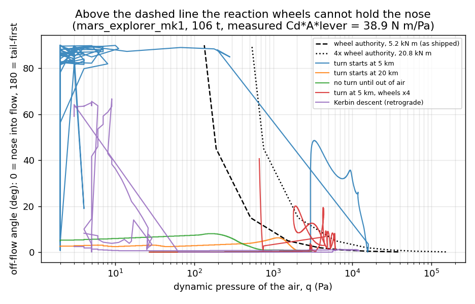
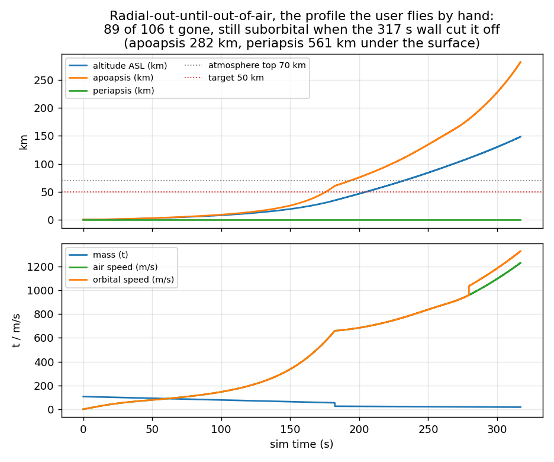
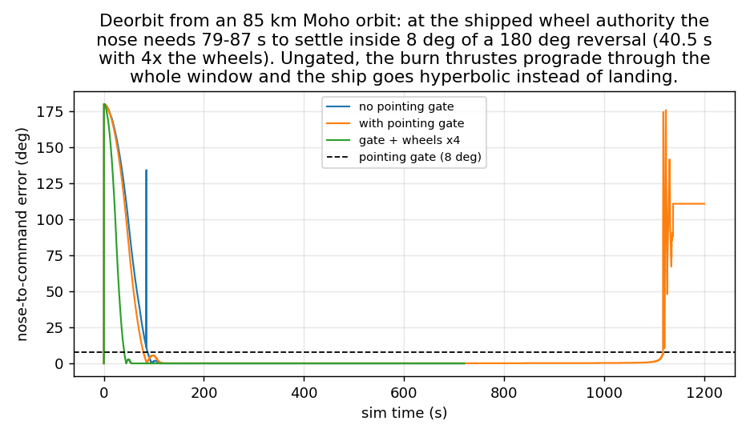

# Ascent / descent autopilots — MVP v1 (measured)

Date: 2026-10-24. Author: Qwen Code (autonomous overnight investigation).
Status: **proposal backed by measurements, no shipped code.** A ~470-line
prototype mission autopilot (`pilot.h`/`pilot.cpp` plus instrumentation hooks in
`tick.cpp`, `vehicle.h/.cpp`, `cli.*`, `main.cpp`) was written to produce these
numbers, then reverted; the whole prototype is in `appendix-patch.diff` here and
`git apply --check` passes against `src/` at `365e19e`. 33 run logs are in
`logs/`; the run tables were generated from them by `scripts/table.py` and are
saved as `logs/table.md`.

The ask: v1 ascent autopilot takes two inputs (circular-orbit altitude ASL and
inclination), v1 descent takes none (just land), auto-staging optional. The
suspicion to test: *"the atmosphere will be problematic — ship tumbles very
quickly when going off prograde"*, and *"maybe v1 only reliably works on bodies
without atmosphere."*

## Verdict

The suspicion is right about the symptom and half-right about the cause.

1. **Descent v1 works today** — on an airless body *and* in an atmosphere, with
   zero player input: Kerbin 85 km → **2 m/s at t=385.7 s**, Moho 85 km →
   **3 m/s at t=1137.6 s**. It works because every phase of a descent wants
   retrograde, and retrograde is the one attitude the aero model leaves
   torque-free. One non-obvious rule is load-bearing: **gate every burn on
   pointing error**, because the wheels take 79–87 s to bring a 106 t stack
   inside 8° of a 180° reversal. Without the gate the deorbit burn thrusts
   prograde through the whole flip and the ship ends up hyperbolic instead of
   landing (`R_moho_land`, ecc 1.24).
2. **Ascent v1 never reached the orbit it was asked for, anywhere.** On Moho,
   where there is no air at all, it did close *an* orbit: 15.8 × 91.0 km for a
   "50 km circular" request (`M_moho_law0`), 16.9 × 50.1 km on the same request
   with an earlier law (`G_moho_ascent_50k`), and 14.7 × 86.9 km at **inc 89.39°**
   for a 90° request (`J_moho_inc90`) — the heading logic is sound, the orbit
   shape is not. On Kerbin no ascent closed an orbit; the profile the user flies
   by hand (radial-out until out of the air) spent **89 of 106 t** and was cut
   off mid-burn at 317 s of sim time with periapsis still 561 km underground
   (`O_kerbin_top`, figure `ascent-kerbin-vertical.png`).
3. **The attitude-authority ceiling is real and tight — but it is not what
   stopped any measured ascent.** Fitting the game's own aero torque gives
   `q·|sin AoA| ≤ 134 Pa` for `mars_explorer_mk1`: at the peak dynamic pressure
   of that sanctioned Kerbin ascent (3 091 Pa) the affordable off-flow angle is
   **2.5°**; the turning profiles that did not hold the nose reached 12–16 kPa.
   The falsification test (§2.4) is the uncomfortable part: the mid-altitude turn
   never exceeded authority at either wheel setting (peak 3 921 N·m against
   5 200; 2 102 against 20 800) and still missed orbit, and the low turn with
   **4× the wheels** still exceeded its own new limit by 10× and still came down.
   So "buy bigger wheels" is **not** supported by these measurements; the
   measured ascent failures are guidance/profile failures, with the authority
   ceiling closing off the obvious escape route.

Recommended v1 scope, in order: **descent now** (it works, two e2e cases to
write); **airless ascent second**, after the guidance rules in §4;
**atmospheric ascent only after thrust vectoring exists** (§5.3).

---

## 1. What exists today

| capability | state | notes |
|---|---|---|
| Attitude | `SlewMode` (prograde, retrograde, radial in/out, normal, anti-normal, kill-rot) driven by reaction wheels only, `Vehicle::slewToward` | braking-curve rate target, torque capped at `maxTorque() = Σ part torque` |
| Thrust vectoring | **absent** (`grep gimbal src/` = 0 hits); see `reports/thrust-vectoring2026_09_26` | engines push along the hull axis, so *attitude == thrust direction* |
| Throttle | `Vehicle::thruster_util` (0..1) + `Command(Thrust)` arm/disarm | `getThrust()` returns thrust **at the current throttle**; `GetActiveThrust()` (full throttle) is `protected` |
| Staging | `activeStage_` counter, engines lit while `part.stage >= activeStage()`, decouplers fire as the counter steps off them and are fuel barriers | a player SPACE press; nothing automatic |
| Aero | per-part drag + lift + chutes; drag applied at the area-weighted centre of pressure; `lastDragAlpha`, `lastAeroTorque`, `lastChuteCdA` probes | weathervane torque exists and is the dominant disturbance |
| Air frame | `airRelativeVel()` and `GetVel()` agree to <0.5 m/s in every logged in-atmosphere row | the air rides the body's rotation, so *prograde is prograde* on the pad; see §2.3 |
| Control surfaces | exist for planes (`ControlDeflection`), separate wing/rudder controls | user's call: wrong shape for rockets, deferred |
| Orbit math | `computeOrbitElements` gives apsides, `time_to_apo`, `radial_vel`; inclination comes from the separate `orbitPlaneAngles` call | good enough to drive guidance directly |
| Proximity warp | while a ship is engaged, `time_accel` is clamped to `--prox-warp` (default 1×) — `game.cpp:1854`, announced by a toast | headless runs lose sim time this way; §7 |
| Rails / warp | physics and pilot code only run below `kRailsWarp` (11); guidance must `leaveRails()` | see §7 |

Two units traps that cost real time, both in `orbit.h`: `periapsis`/`apoapsis`
are **radii from the focus**, not altitudes (`--orbit-log` prints them as-is,
the pilot line in the patch prints them minus the body radius — comparing the
two is off by a whole body radius), and `apoapsis = -1` means non-elliptic, not
"zero". Filed as #404.

## 2. The numbers that decide the design

### 2.1 Attitude authority (fitted from the game's own aero pass)

The prototype logged measured aero torque against wheel limit every tick.
Fitting `tau = k · q · sin(AoA)` over 14 968 usable samples from the archived
Kerbin runs:

```
k = Cd * A_projected * lever = 38.9 N m per Pa   (median; IQR 18.2-66.0)
wheel authority               = 5 200 N m         (200 + 2 000 + 3 000 part torques)
=> the wheels can hold:        q * |sin(AoA)| <= 134 Pa
```

`scripts/authority.py` recomputes this from the logs; its output, verbatim:

| off-flow angle | max q, 5 200 N m wheels | max q, 2 000 N m wheels |
|---|---|---|
| 0.2° | 38 323 Pa | 14 740 Pa |
| 0.5° | 15 330 Pa | 5 896 Pa |
| 1.0° | 7 665 Pa | 2 948 Pa |
| 2.0° | 3 833 Pa | 1 474 Pa |
| 5.0° | 1 535 Pa | 590 Pa |
| 10° | 770 Pa | 296 Pa |

(The second column is a hypothetical weaker wheel set, computed by the same
script, to show how the ceiling moves with hardware.)

Same ceiling as airspeed, at fixed density:

| rho (kg/m³) | AoA 1° | AoA 2° | AoA 5° |
|---|---|---|---|
| 1.15 (near the deck; logs peak at 1.17–1.26) | 115 m/s | 82 m/s | 52 m/s |
| 0.50 | 175 | 124 | 78 |
| 0.26 | 243 | 172 | 109 |
| 0.10 | 392 | 277 | 175 |
| 0.02 | 876 | 619 | 392 |

**Read it as: the affordable angle scales with `q`, and near the deck that is
about one degree below 115 m/s.** Where `O_kerbin_top` actually crosses
115 m/s of airspeed — t = 82.2 s, 5.6 km up — the recovered density is 0.44, so
the ceiling there is ~186 m/s. It reaches its peak `q = 3 091 Pa` at t = 104.3 s
at **8.6 km ASL** with the nose held to **0.7°** off the flow, and the affordable
angle at that point is `asin(134/3091)` = **2.5°**. The margin is a couple of
degrees, not a wide safety band; a profile that asks for more stops flying.

Note the convention: `lastDragAlpha` is the angle between nose and air-relative
velocity, so **tail-first (AoA ≈ 180°) is torque-free** (`sin ≈ 0`). The
quantity that costs authority is the *off-flow* angle `min(AoA, 180 − AoA)` —
which is what the table header and the figure's y-axis now say. A ship parked
backwards in a stream is not fighting it.

The wide IQR on `k` is real: the cp lever is under a metre and its sign moves.
Across well-behaved runs `cpLev` stays in **−0.42 … +0.82 m**; the larger
magnitudes (**−1.37 m in `P_kerbin_low`**, −1.16 m in `P_t4`) appear in runs that
have already gone sideways. In `P_t4` the lever exceeds 0.9 m at t = 332 s, one
second before the first row over 30° off-flow, so which came first is
definition-dependent at this sample size — but in both cases it is the tumbling
run that has the big lever, not the well-flown one.

### 2.2 Slew authority (the one nobody expected)

Wheels are weak against the vehicle's own moment of inertia, not just against
air. Measured on the 106 t stack, in vacuum, from the logged `ptRate` column.
"Settle" is the first logged row (0.1 s cadence) after t = 30 s whose pointing
error is under 8°:

```
angular acceleration  plateaus at 0.100 deg/s^2  (1.75e-3 rad/s^2)
                      -> implied Ieff ~ 3.0e6 kg m^2   (5 200 N m / 1.75e-3)
180 deg commanded reversal, time to settle inside 8 deg of pointing error:
      87.3 s   R_moho_land      (no throttle gate)
      78.8 s   AA_moho_land3    (gate on, wheels as shipped)
      78.8 s   U_moho_land2     (gate on)
      40.5 s   U_t4             (gate on, 4x wheel torque)  <- ~sqrt(4), as expected
```

The `ptRate` column reaches 1.2 deg/s in `L_moho_law1` and 3.6–3.9 deg/s during
the Moho deorbit flips, so the *rate* a turn program asks for is usually
reachable; what is not available is **starting and stopping the slew on
schedule**. At 0.1 deg/s², reversing 180° bang-bang costs ~90 s, and any thrust
during that window pushes in a direction the guidance has already abandoned.

Consequences, all observed:

* A deorbit burn commanded at the phase change is a **prograde** burn for the
  first ~80 s. Un-gated, that put the ship on an escape trajectory
  (`R_moho_land`, ecc 1.24) instead of deorbiting it (figure `pointing-lag.png`).
* Gating every burn on pointing fixes descent but, applied bluntly, **kills
  ascent**: with a fixed 8° gate the Moho ascent never got above **2.1 km**
  apogee and was back on the pad at t = 82 s (`W_moho_law1g`, `X_moho_law0g`) —
  the gate opened for the first 9.5 s and never reopened during the turn, so
  the ship could not burn its way out of the pad. Guidance must *rate-limit
  itself to the actuators*, not merely check them; what worked in build D gated
  only the *throttle* (25° during ascent, 8° elsewhere) and left the turn itself
  rate-limited (§4.5).
* A turn profile written in deg/s is meaningless unless the ship can also
  *arrest* the slew: `Y_moho_law1s` (slew-aware turn, gate on) still did not
  close its orbit and gated 634 ticks.

Per-ship wheel authority from the shipped defs (`scripts/shipspec.py`, paper
model, liftoff mass including propellant):

| ship | liftoff | wheel torque | N m per tonne |
|---|---|---|---|
| tanker | 17.2 t | 200 | **12** |
| central_radial | 4.0 t | 200 | 50 |
| laythe_explorer | 3.9 t | 200 | 51 |
| labpod | 2.6 t | 200 | 77 |
| baropod | 2.6 t | 200 | 77 |
| mars_explorer_mk1 | 106.4 t | 5 200 | 49 |
| heavy_asp | 97.1 t | 9 700 | 100 |
| heavy_one | 76.1 t | 9 700 | 127 |
| heavy_two | 60.1 t | 9 700 | 161 |
| power_test | 23.9 t | 4 950 | 207 |
| ranger | 6.0 t | 2 200 | 368 |
| stager | 4.1 t | 2 200 | 532 |
| racer | 2.7 t | 2 200 | 824 |
| small_docker | 2.0 t | 2 200 | 1 075 |

(Angular acceleration also scales with 1/L², so N m/t is a proxy, not the
metric. `tanker` is the worst-served ship in the game by a factor of four, and
the small capsules are badly under-wheeled too.)

### 2.3 Frames: the trap is inertial vectors, not "prograde on the pad"

An earlier draft of this report claimed that on Kerbin "orbital prograde is
~90° off the air flow" on the pad, because the ground co-rotates east at
174.9 m/s (ω = 2.916e-4 rad/s). **The logs do not support that.** In every
archived in-atmosphere row — 2 708 of 2 708 in `AC_kerbin_pad_prograde`, 14 408
of 14 408 in `V_kerbin_land2` — `airRelativeVel()` and `GetVel()` agree to under
0.5 m/s: the game's air already moves with the body, so prograde on the pad is
prograde through the air. Co-rotation shows up only above the air, where the
guidance switches to inertial references (max disagreement in these runs is
99–118 m/s, around 148 km).

What *is* a trap is the frame of the guidance vector. `slewToward` consumes
`guidanceDir` in `ship->frame` (rotating) axes, so an inertial vector must be
rotated with `inertial->GetOrientRelTo(ship->frame)` before it is handed over.
The prototype got this wrong and mis-pointed by the co-rotation angle out where
there is no air at all.

The archived pad experiment (`AC_kerbin_pad_prograde`: command the turn at 200 m
instead of at 5 km) is still the clearest picture of low-altitude turning: peak
`q` 4 496 Pa at 259 m, `|AoA|` peaked at **179.4°**, aero torque peaked at
**357 585 N·m** (69× wheel authority), 565 of 2 708 ticks over authority, apogee
**1.3 km**, back on the pad at t = 61 s having burnt 8.6 t. The ship ended up
flying *backwards* — the torque-free attitude — because that is the only place
the air leaves it alone.

### 2.4 Falsification: 4× the wheels changes nothing that mattered

The headline causal claim ("tumbles because the wheels are too weak") deserves a
direct test, so I ran it: `res/data/parts.json` wheel torques ×4 (capsule
200→800, reaction_wheel 2000→8000, r1.5h0.375 3000→12000 → 5 200 → **20 800 N·m**
on the mex), same prototype, same cases. The archived `_t4` logs print
`tau_wheel=20800` in every row, so the change is visible in the evidence.

| case | wheels | gate | over-authority rows | peak aero torque | off-flow max | outcome |
|---|---|---|---|---|---|---|
| `P_kerbin_low` (turn at 5 km) | 5 200 | off | 1 132 / 10 809 | 107 512 N m | 90.0° | apogee 9.6 km, down at 162 s |
| `P_t4` | **20 800** | on | 1 367 / 10 807 | **207 507 N m** | 40.7° | apogee 21.7 km, down at 341 s |
| `Q_kerbin_mid` (turn at 20 km) | 5 200 | off | **0 / 10 808** | 3 921 N m | 6.3° | apo 276 km, peri −544 km |
| `Q_t4` | **20 800** | on | **0 / 10 808** | 2 102 N m | 4.1° | apo 259 km, peri −566 km |
| `U_moho_land2` (Moho landing) | 5 200 | on | 0 | 0 | – | reversal settles in 78.8 s |
| `U_t4` | **20 800** | on | 0 | 0 | – | reversal settles in 40.5 s |

Read the pairs honestly:

* `U_moho_land2` vs `U_t4` is the **only clean wheels-only A/B** in the archive,
  and it behaves exactly as the physics says: 78.8 s → 40.5 s, a factor of 1.94
  against a torque ratio of 4 (√4 = 2). Where the limit really is the actuators,
  ×4 actuators buys ~2×.
* `P`/`P_t4` and `Q`/`Q_t4` change **two things at once** (wheels and the
  pointing gate, §3 lineage), so they are not clean A/Bs. What they still show:
  with ×4 wheels and the gate, the 5 km turn exceeded its *new* authority limit
  by 10× at peak (207 kN·m against 20.8) and still came down; and the 20 km turn
  stayed inside authority **at either setting** — 3 921 N·m peak against 5 200,
  2 102 against 20 800 — and did not reach orbit either way.
* So for the ascents, the wheels were not demonstrated to be the binding
  constraint at any setting: in `Q` they were never over authority at all, and in
  `P` the disturbance scaled past a 4× larger limit. Any claim that bigger wheels
  "fix" atmospheric ascent is unsupported here; the aero torque grows until it
  saturates whatever limit exists (§8, #403).

## 3. Measured runs

31 of the 33 archived logs carry prototype `[pilot]` rows (`mars_explorer_mk1`,
headless offscreen, `--time-accel 4`, `--orbit-log --orbit-interval 30`); the
other two (`A_kerbin_radialout`, `C_moho_radialout`) are early probes of the
**shipped** `--autopilot radial-out`. `logs/table.md` is the generated table over
those 31 cases; the two cuts below are 20 of them, split for reading. The `sim s`
column is the actual sim time reached — effective sim time varies per run
because of the proximity warp cap (§7), so the cuts are *not* equal-horizon
comparisons.

**Log lineage.** The four prototype builds differ in instrumentation, and the
`build` column is read off each log's own field set: **A** = attitude/aero
probes only, **B** = + guidance debug (`dv/vneed/amax/gap`), **C** = +
pointing probes (`ptErr/ptRate`, also `ptAcc`/`Ieff`, which printed zeros),
**D** = + the pointing gate and the slew-aware turn (`gated=`). **Only build D
can be rebuilt from `appendix-patch.diff`**; the `A`–`C` rows are archived
measurements, not reproducible from the shipped patch.

The **gate is a runtime option, not a field**, so its column is read from
behaviour, and behaviour differs by build:

* build **A/B** logs have no pointing probe at all → gate state unknowable (`—`).
* build **C**, gate off (`K, L, M, N, O, P, Q, R, S`): rows thrusting while more
  than 8° off the commanded attitude = 537–4 203, of which 0–2 317 also exceed
  25°.
* build **C**, blunt 8° gate on (`W, X, U_moho_land2, V_kerbin_land2`): 0 rows.
* build **D**, slew-aware turn + throttle gate at 25° in ascent / 8° elsewhere
  (`AA, Z, AB, AC, P_t4, Q_t4, U_t4, Y_moho_law1s`): 0 rows above 25° in every
  run, and 56/190/903 rows in the 8–25° band in `AC`/`P_t4`/`Y_moho_law1s` — the
  ascent mode deliberately allows more. Gated ticks: `AA 2 421`, `P_t4 8 135`,
  `AC 2 257`, `Z 1 003`, `AB 941`, `Y 634`, `U_t4 607`, `Q_t4 388`.

Where this report compares gated against ungated (`R` vs `AA` for the §2.2
claim), the build changed as well, so those are strong indications plus the
behavioural counts above, not isolated A/Bs.

### 3.1 Ascent

| case | build | gate | body | vertical leg until | outcome | dv spent | burnt / jett t | off-flow max | peak tau | over-auth |
|---|---|---|---|---|---|---|---|---|---|---|
| `O_kerbin_top` | C | off | Kerbin | 70 km (atmosphere top) | suborbital, apo 282 km, peri −561 km | 3 663 | 60.2 / 28.9 | 8.1° | 1 874 | 0 / 10 810 |
| `Z_kerbin_tops` | D | on | Kerbin | 70 km | suborbital, apo 770 km, peri −464 km | 4 530 | 68.5 / 28.9 | 8.1° | 1 874 | 0 / 18 007 |
| `Q_kerbin_mid` | C | off | Kerbin | 20 km | suborbital, apo 276 km, peri −544 km | 3 663 | 60.2 / 28.9 | 6.3° | 3 921 | 0 / 10 808 |
| `AB_kerbin_mids` | D | on | Kerbin | 20 km | suborbital, apo 792 km, peri −402 km | 4 531 | 68.5 / 28.9 | 6.3° | 3 921 | 0 / 18 008 |
| `P_kerbin_low` | C | off | Kerbin | 5 km | apogee 9.6 km, down at 162 s | 2 530 | 46.6 / 0 | 90.0° | 107 512 | 1 132 / 10 809 |
| `P_t4` | D w4 | on | Kerbin | 5 km, ×4 wheels | apogee 21.7 km, down at 341 s | 2 885 | 51.2 / 0 | 40.7° | 207 507 | 1 367 / 10 807 |
| `AC_kerbin_pad_prograde` | D | on | Kerbin | 200 m | apogee 1.3 km, down at 61 s | 372 | 8.6 / 0 | 90.0° | 357 585 | 565 / 2 708 |
| `M_moho_law0` | C | off | Moho | node-centred law | **orbit 15.8 × 91.0 km** | 1 172 | 24.9 / 0 | – | 0 | 0 / 10 810 |
| `G_moho_ascent_50k` | B | — | Moho | earlier law | **orbit 16.9 × 50.1 km** | 3 488 | 58.3 / 28.9 | – | 0 | 0 / 12 008 |
| `J_moho_inc90` | B | — | Moho | 90° inclination request | **orbit 14.7 × 86.9 km, inc 89.39° (transient 91.17°)** | 1 172 | 24.9 / 0 | – | 0 | 0 / 14 408 |
| `L_moho_law1` | C | off | Moho | continuous-burn law | suborbital at the wall, peri −182.5 km (declared "done" at t = 73.8 s) | 977 | 21.2 / 0 | – | 0 | 0 / 10 810 |
| `Y_moho_law1s` | D | on | Moho | same, slew-aware turn + throttle gate | suborbital at the wall, peri −172.2 km | 1 041 | 22.4 / 0 | – | 0 | 0 / 18 008 |
| `W_moho_law1g` | C | on | Moho | blunt 8° gate | apogee 2.1 km, down at 82 s | 115 | 2.7 / 0 | – | 0 | 0 / 14 409 |
| `X_moho_law0g` | C | on | Moho | same, node-centred law | apogee 2.1 km, down at 82 s | 115 | 2.7 / 0 | – | 0 | 0 / 14 409 |

`L` and `Y` are *cut off at the wall* before reaching their periapsis, so
"impact" is an extrapolation of the arc, not a logged touchdown; what is logged
is that the closure test was satisfied (`ph=done` at t = 73.8 s, 23 km altitude)
on an arc whose periapsis is ~180 km underground.

Reference numbers from `scripts/shipspec.py`: ideal impulsive Δv from rest at
Kerbin's surface to a **70 km circular orbit ≈ 2 564 m/s**; the mex's first
stage alone is credited **4 647 m/s** at its own exhaust velocity, and the
later stages 6 313 / 4 321 / 3 949 m/s (the top nuclear stage has a much higher
`ve`, which is why these cannot simply be summed into one number). Propellant
is not the constraint: the Kerbin runs spent 3.6–4.5 km/s of propulsive Δv and
still did not close an orbit. The loss is in the profile — vertical climb plus
thrust delivered while the nose is off the commanded direction — not in the
tanks.




### 3.2 Descent ("no inputs, just land")

| case | build | gate | body | start | outcome | phase timeline (sim s) | burnt t |
|---|---|---|---|---|---|---|---|
| `R_moho_land` | C | off | Moho | 85 km circular | **hyperbolic**, ecc 1.24 (apoapsis printed −1: non-elliptic) | deorbit 0 → dive 71.5 → wall | 20.6 |
| `AA_moho_land3` | D | on | Moho | 85 km circular | **soft landing, 3 m/s at t=1137.6 s** | deorbit 0 → dive 83.3 → brake 827.1 → done 1137.6 | 19.7 |
| `U_moho_land2` | C | on | Moho | 85 km circular | still braking at the 960 s wall (peri −62.6 km) | deorbit 0 → dive 83.3 → brake 827.1 | 3.5 |
| `U_t4` | D w4 | on | Moho | 85 km circular, ×4 wheels | still diving at the 720 s wall (peri −1.6 km) | deorbit 0 → dive 45.1 | 1.3 |
| `S_kerbin_land` | C | off | Kerbin | 85 km circular | thrown to a 1 229 km apoapsis, suborbital at the wall | deorbit 0 → dive 72.5 → brake 72.6 | 36.8 |
| `V_kerbin_land2` | C | on | Kerbin | 85 km circular | **soft landing, 2 m/s at t=385.7 s** | deorbit 0 → dive 83.6 → brake 83.7 → done 385.7 | 35.0 |

The apoapsis in `R_moho_land` is not a usable number: while the burn was still
running the pilot-line apoapsis peaked at 2.4e5 km, and once the state went
hyperbolic the element log prints −1 (§1).

`V_kerbin_land2` exceeded wheel authority in 363 of 14 408 ticks (peak
7 451 N·m at ~11 km, i.e. 1.4× the limit — *not* near the deck, where `q` is
gone), reached an off-flow angle of 66.7° during entry, and still touched down
at 2 m/s. Descent tolerates authority excursions; ascent does not.



The Kerbin descent is the strongest single result: deorbit, dive, closed-loop
brake, 2 m/s touchdown, **zero player input**, in an atmosphere, 302 s from the
first post-flip ignition.

## 4. What the prototype learned about guidance laws

These failed specifically; they should be written down before anyone writes the
real thing.

1. **Never read `getThrust()` for available acceleration.** It is scaled by
   `thruster_util`, which the autopilot itself commands, so a coasting vehicle
   reports `a_max = 0` and a circularization law built on it can never restart.
   The full-throttle primitive `GetActiveThrust()` is the right one and is
   `protected` — that API needs to change (§6.1).
2. **Guidance directions must be in `ship->frame` axes** (§2.3), and apsides
   must be compared in one unit convention (§1).
3. **Apoapsis-gap windows are the wrong circularization gate.** Gating on
   `(apo − r) < ε` starts the burn wherever the tick happens to fall; a
   high-TWR ship then spends most of the burn off-node. Predict the node
   (`el.time_to_apo`), start half a burn-duration early, **capture the node
   radius at burn entry**, and stop against the *captured* node — the
   moving-apsis version chases its own tail and overshot to escape.
4. **A speed-based "orbit achieved" test lies.** The continuous-burn law
   (`--pilot-law 1`) hit its target speed at 23 km altitude on a steeply
   suborbital arc and declared `done` at t = 73.8 s; the archived arc's
   periapsis is **−182.5 km** (`L_moho_law1`; the slew-aware variant
   `Y_moho_law1s` gives −172.2 km). The closure test must be on apsides:
   `periapsis >= target − tol` **and** `periapsis > terrain + margin` before
   anything says "done".
5. **Turn commands must be limited by what the actuator can start *and stop*.**
   A gate that only throttles (8° on everything) opens for the first few seconds
   and then never lets the ship burn again during the turn, pinning it near the
   pad (§2.2, `W`/`X`). What worked better in build D: rate-limit the *commanded*
   turn to a slew-aware target and gate the throttle at a wider angle (25° during
   ascent, 8° elsewhere). `Y_moho_law1s` still gated 634 ticks and still did not
   close the orbit — a tuning target, not a solved rule.
6. **Auto-staging works, on one ship, once.** The rule "stage if any lit engine
   has less than 1.5 s of propellant in any pool" dropped the asparagus boosters
   at the right moment in `O`/`Q`/`Z`/`AB` (28.9 t jettisoned). n=1. Decouplers
   are fuel barriers, so the fuel-group bookkeeping needed no extra care.
   **The chute-deploy rule is untested**: `mars_explorer_mk1` carries no chute
   part, so `--pilot land` never exercised it.
7. **The brake trigger must be honest about where it fires.** In the two
   landings, braking was continuous, not event-triggered: Kerbin engaged
   `BRAKE` at t = 83.7 s (0.1 s after the dive) and Moho at t = 827.1 s, because
   the trigger is a target-speed test
   `v_tgt = 1.15 · sqrt(2 · a_net · h)` with `a_net = T/m − g_local`, so it
   engages immediately when thrust dwarfs weight and late when it does not. Both
   landed. An earlier variant of the same test fired during the *climb-out* of
   the deorbit burn and turned a Kerbin descent into 650 s of continuous braking
   (`S_kerbin_land` is the same failure mode at the wall). The `radial_vel < 0`
   refinement in §5.1 is **proposed, not measured**.

## 5. Proposed v1 (what to actually build)

### 5.1 Ship first: descent autopilot ("land")

States `DEORBIT → DIVE → BRAKE`, plus chute handling.

* `DEORBIT`: nose = retrograde (air-relative when in air). Burn only once the
  pointing error is inside the gate. End when `periapsis <= terrain + margin`.
* `DIVE`: coast retrograde. If a chute is fitted, `rho > 0`, airspeed below
  `lastChuteCdA`'s speed limit and under ~5 km: stage to deploy it.
* `BRAKE`: closed loop on closing speed, retrograde, throttle from
  `a_need / a_avail`. Done when grounded.
* Autostage toggle (default on).

Two rules that the measurements say are mandatory, and one that is not yet
proven:

* **Gate the burn on pointing** (measured: without it, Moho deorbit = hyperbolic).
* **Expect braking to be continuous**, and budget sim time for it (measured:
  Kerbin dive at 83.6 s, brake at 83.7 s, touchdown at 385.7 s; Moho brake-in at
  827.1 s, touchdown at 1 137.6 s — 310 s of braking, 1 138 s from engage). A
  descent autopilot that "hops" needs a hover/flare rule, which v1 should *not*
  attempt.
* **Trigger braking on `radial_vel < 0` plus the stopping-distance test** —
  proposed refinement to avoid the §4.7 failure; untested.

Acceptance (v1). Sim-time budgets assume the proximity warp cap may hold a
low-altitude ship at 1× (§7), so the wall-clock cost is roughly the budget in
seconds unless `--prox-warp` is raised:

| case | from | to | tolerance | sim-time budget |
|---|---|---|---|---|
| e2e `land-moho` | `--startship mex,…,Moho,rot-orbit` (85 km) | touchdown | speed < 10 m/s, no player input after engage | ≤ 1 400 s |
| e2e `land-kerbin` | `--startship mex,…,Kerbin,rot-orbit` (85 km) | touchdown | speed < 10 m/s | ≤ 500 s |
| e2e `land-moho-ungated-negative` | as `land-moho`, gate disabled | must **not** land (goes hyperbolic) | guards the gate rule against regression | – |

The prototype already achieves 3 m/s and 2 m/s on those two beds, so the first
two cases are expected-pass once the code exists. The wall-clock cost is real:
at 1× near the deck a 1 400 s Moho budget is ~1 400 s of wall time per case,
which is why the descent e2e set should stay at two cases plus one negative, and
why these should not run on every CI push.

### 5.2 Second: ascent autopilot for airless bodies only

Inputs as asked: circular altitude ASL, inclination.

* `TURN`: pitch over toward the heading that yields the requested inclination
  (`d̂ = cos i · east + sin i · north`, from the body's ω), at a slew-aware
  rate, ending horizontal. Do **not** burn vertically on an airless body — the
  prototype's Moho vertical leg wasted Δv that the closed orbits it did reach
  could not afford.
* `PROGRADE`: burn to the target apoapsis.
* `COAST → CIRCULARIZE`: node-centred burn against the captured node radius,
  throttled to the Δv still owed.
* **Success test**: apsides inside tolerance *and* above terrain; otherwise
  report the achieved orbit and stay engaged. The prototype's own tolerance was
  `max(200 m, 0.001 · r)`; a v1 that must satisfy a player should use
  **±5% of the requested altitude on both apsides**, which is what the e2e
  assertions below use.
* Measured state of the art, all on Moho against a 50 km request: **16.9 × 50.1 km**
  (`G_moho_ascent_50k`, the closest to the acceptance band), **15.8 × 91.0 km**
  (`M_moho_law0`) and **14.7 × 86.9 km at inc 89.39°** (`J_moho_inc90`). The
  plane is right, the shape is wrong: the circularization burn is the piece to
  fix, and it is fixable with wheels alone because there is no aero torque out
  there.

Acceptance (v1):

| case | from | request | tolerance | sim-time budget |
|---|---|---|---|---|
| e2e `ascend-moho-50` | `--startship mex,…,Moho,pad` | 50 km circular, prograde-equatorial | apo and peri within 50–55 km, i.e. ±5% | ≤ 2 400 s |
| e2e `ascend-moho-inc90` | same | 50 km, inc 90° | as above plus inc within 1° of 90° | ≤ 2 400 s |

Both are expected-fail today (the shape is wrong, and the runs used 1–3.5 km/s
of the available Δv before the wall); they are the definition of "done" for
this step, not a snapshot of it.

### 5.3 Deferred until thrust vectoring exists: atmospheric ascent

The inclination input in particular is unachievable in the air today: holding a
heading while turning inside the lower atmosphere is exactly the manoeuvre the
wheels cannot power (§2.1), and §2.4 shows that scaling the wheels does not buy
it back.

The case for TVC, in one number: a 1.27 MN engine with even ±1° of gimbal on a
10 m arm produces **~22 kN·m of control torque**, 4× the entire wheel suite, and
it scales with throttle instead of fighting the air. TVC plus the existing aero
model makes the atmospheric turn a *controllable* manoeuvre. Without it the
onboard computer can only fly radial-out, and radial-out cannot reach orbit:
`O_kerbin_top` stayed inside wheel authority for **all 10 810 ticks** (peak
1 874 N·m, peak off-flow 8.1°) and ended 561 km short.

The user's hand-flown note is consistent with this: `mars_explorer_mk1` is
locked radial-out until clear of the air, and "otherwise it's hopeless".

Also deferred: aerodynamic control surfaces for rockets (wings/rudders are
plane-shaped today, with separate controls — the user's call, agreed).

## 6. Engine work the autopilot needs (independent of the autopilot)

1. **A public "available thrust" read** (`GetActiveThrust()` public, or
   `Vehicle::availableAccel()`); today guidance re-implements the parts loop
   because `getThrust()` is throttle-scaled and `GetActiveThrust()` is
   `protected`. Filed as #400.
2. **Steerability feedback in the VAB/autopilot UI**: wheel torque, current
   aero torque `q·CdA·lever`, and the resulting "max q at 1° off-flow" for the
   ship on the pad. This is the diagnostic that turns a mysterious tumble into
   a number the player can act on, and it is a few lines on top of the existing
   probes.
3. **Expose the attitude error** (`lastSlewErr`, body rate) in the debug
   overlay; an autopilot cannot be tuned without it. The prototype added both as
   public probes in `vehicle.h` — the patch shows the shape. (It also added
   `ptAcc`/`Ieff` probes that printed zeros in every log: the derivation was
   never wired up, so do not trust those two fields.)
4. **Wheel sizing is a question, not a fix.** 5 200 N·m on a 106 t stack gives
   1.75e-3 rad/s² (0.100 deg/s²), and `tanker` gets 12 N·m/t. Worth an issue and
   a pass over `res/data/parts.json` — but §2.4 shows quadrupling the wheels
   changed no ascent outcome, so size it against *slew time* (how long a 180°
   reversal feels to a player; target ~25 s on the heaviest stock rocket), not
   against the aero torque. Filed as #401.
5. **Crew guard**: an autopilot that engages while a kerbal is on EVA, or while
   the ship is docked/multi-select, needs a defined answer. The prototype just
   drove the active ship.

## 7. Harness notes

* **Headless runs lose sim time to the proximity warp cap, not to an
  accumulator clamp.** While a ship is *engaged*, `time_accel` is clamped to
  `--prox-warp` (default **1.0**) in `game.cpp:1854`, with the toast
  `Close approach: time accel limited to 1x`. 12 of the 33 archived runs printed
  that toast; `O_kerbin_top` and `Q_kerbin_mid` reached only 317 s of sim from
  180 s of wall, while `M_moho_law0` got the full 720 s. This is deliberate and
  announced, but it means `--timeout W --time-accel N` does **not** buy `W·N`
  seconds of sim time, and cross-run comparisons must use the logged sim time.
  A second, self-inflicted version of this bug was in the prototype itself: its
  engage hook did `g.time_accel = 1`, which is what produced the 4.00× → 1.00×
  step I first blamed on the engine. Issue #402 was reopened with the correct
  mechanism.
* `--orbit-log --orbit-interval` gates on **wall** clock (`logDue(..., SDL_GetTicks())`),
  so at `--time-accel 4` the element samples are 80–120 s of *sim* time apart.
  Once a lander is on the ground with v ≈ 0 the elements go degenerate (ecc → 1,
  apoapsis → current radius). Filter to airborne rows (`v > 50 m/s`) before
  believing them, as `scripts/table.py` does.
* There is no `--drag-interval` flag; passing it aborts the run with an
  "arguments were not expected" error.
* The prototype's per-tick `[pilot]` line (see `appendix-patch.diff`) was the
  right instrumentation: guidance state, orbit, aero, pointing in one line.
  Worth keeping as a `--pilot-log` flag when a real autopilot lands.
* `--startship <name>,<def>,<body>,<scenario>` beds fit autopilot e2e well:
  `rot-orbit` for descent (85 km circular), `pad` for ascent.

## 8. Risks / open questions

* **Is the aero torque model right?** `k = 38.9 N m/Pa` is measured from the
  game's own drag pass, but the cp lever comes from projected area and its sign
  moves once a run has tumbled (§2.1). A ship that is weathervane-*unstable*
  mid-flight is a modelling question as much as a gameplay one.
* **Projected drag area for the asparagus stack** was measured earlier at
  ~114 m² prograde (four r2.25 boosters around the core): "pointed" drag is
  enormous, which is what makes `k` so large. Re-checking the silhouette
  projection is worth its own issue.
* **Why does the 5 km turn tumble harder when the wheels are 4× stronger?** The
  disturbance grows until it saturates whatever limit exists (§2.4), which
  smells like positive feedback in the aero pass (torque → off-flow angle →
  more torque) rather than a fixed limit. Nobody has isolated it; it is the
  single most interesting open question in this report, and it is the one an
  onboard autopilot has to live with. Filed as #403.
* **TWR is very high** (1.21 at Kerbin liftoff, ~10 on Moho late in the burn).
  Autopilot tuning is TWR-dependent: a low-TWR ship needs coast-then-circularize,
  a high-TWR ship needs slew-limited continuous burn. v1 should pick the law from
  TWR rather than hard-code either.
* **Nothing here says the player autopilot should be bang-bang**: every
  successful run used throttling.
* **Autostage is n=1 and the chute rule is untested** (§4.6).
* **Some comparisons in here are not clean A/Bs** (§2.4, §3 lineage). The gate,
  the build, and the wall length all moved between some pairs; the clean pairs
  are called out where they exist.

## 9. Suggested order of work

1. Fix the API warts (§6.1–6.3) — no behaviour change, unblocks everything.
2. Descent autopilot + the three e2e cases in §5.1. Measurable, player-visible,
   works today.
3. Attitude-authority readout in the VAB (§6.2) — turns a mysterious tumble into
   a number.
4. Airless ascent autopilot + the two e2e cases in §5.2 (the plane logic already
   holds **inc 89.39°** for a 90° request; the apsides do not).
5. Investigate the aero feedback question in §2.4/§8 (#403) before committing to
   any atmospheric profile.
6. Thrust vectoring (its own report exists), then atmospheric ascent.

## Issues filed from this work

* **#399** *A rocket cannot hold one degree of angle of attack* — kept for the
  VAB steerability readout; **amended** with the §2.4 falsification so nobody
  reads it as "make the wheels bigger".
* **#400** *An autopilot cannot ask "how fast could I accelerate right now"* — §6.1.
* **#401** *Flipping a big rocket 180 degrees takes ~100 seconds* — sharpened
  with the measured 78.7 / 87.2 / 40.5 s figures and the per-ship N m/t table.
* **#402** *Headless runs with --time-accel silently lose sim time* — the real
  mechanism is the proximity warp cap (§7); I first closed it wrongly, and it
  has been reopened with the correct explanation and the `--prox-warp` note.
* **#403** *A rocket that starts tumbling tumbles harder* — the open question in
  §8, with the ×4-wheel repro.
* **#404** *Guidance code must convert orbit apsides twice* — the §1 units trap.
* **#398** *(pre-existing) `make test` red: the VAB ship list test forgot the new
  default ship* — unrelated to this work; it is the one failing check at HEAD
  (the other binary is 333 checks, 0 failures).

## Appendix — reproducing this

```
# apply the prototype (deliberately not in src/), rebuild
git apply reports/autopilots2026_10_24/appendix-patch.diff && bear -- make

# the run matrix: 16 of the 33 archived cases, logs land in tmp/ap/.
# It has no switch for the x4-wheel catalog used by the _t4 rows - that edit
# was made by hand in res/data/parts.json and reverted (see section 2.4).
bash reports/autopilots2026_10_24/scripts/matrix.sh O_kerbin_top Q_kerbin_mid P_kerbin_low

# from inside reports/autopilots2026_10_24/
python3 scripts/table.py    logs/*.log            # the run tables (logs/table.md)
python3 scripts/authority.py logs/O_kerbin_top.log logs/P_kerbin_low.log \
                             logs/Q_kerbin_mid.log logs/V_kerbin_land2.log \
                             logs/S_kerbin_land.log logs/AB_kerbin_mids.log \
                             logs/F_kerbin_ascent_100k.log
python3 scripts/figures.py  .                     # the three PNGs
python3 scripts/parse.py    logs/AA_moho_land3.log # per-run timeline + extremes
```

`logs/` holds the raw runs (33) and the generated `table.md`. The raw `.log`
files stay on this machine (`logs/.gitignore` keeps 85 MB of them out of git);
the generated `logs/table.md` is committed. `scripts/` holds
`table.py`, `authority.py`, `analyze.py` (superseded by `table.py`, kept for its
density accounting), `parse.py`, `figures.py`, `shipspec.py`, `matrix.sh`. The
×4-wheel logs are named `*_t4.log` and carry `tau_wheel=20800` in every row. The
parts-catalog edit used for them is **not** shipped — `res/data/parts.json` is
back at HEAD, `src/` is clean, `make test` shows only the pre-existing #398
failure.
